# Usuba: what we learned trying to teach a small model to write Omarchy plugins, and why we're building the checker first

*By Harris Kenny · OutboundSync · DRAFT v0.7 (epochs, decision context, appendices; post-update pass of Friday evening, Oct 16, 2026) · usuba.dev*

## TL;DR

**A plain piece of code, the Usuba Checker scripts, judges Omarchy plugins better than any small model we tested.** On the 75-plugin Dell exam it scores 0.773 verdict accuracy [0.667-0.853], with no model. In one-shot runs no model scores above 0.56. With a Checker feedback loop the best model (Gemma 4 26B) reaches 0.65 [0.55-0.76]. Always answering "broken" would score 0.373. Our fine-tuned model, Usuba run 2, learned the answer format (99% valid answers on the Dell set against 89% for its stock base) but not the judgment (0.48 [0.37-0.59] against 0.51 [0.40-0.61] for stock). So the first release is the Checker scripts and a public standard. The model ships labelled "In Training," as an invitation to help, not as a win.

> **In this series**
>
> - Part 1 · Build: We set out to teach a 9B model to review Omarchy plugins. We built a clean training set from git history and trained two LoRA runs (4,592 training rows for run 1, 221 for run 2). Neither beat its stock base on judgment.
> - Part 2 · Evaluate: The Checker scripts score 0.773 on the Dell 75. No model is above 0.56 one-shot, or above 0.65 with the Checker loop. We also show how our own scores lied to us before we fixed the exams.
> - Part 3 · Own: We release the model as "In Training," say plainly it did not clear the bar, and ask for data, bug reports and compute.

## The exams and the scoreboard at a glance

Every score in this post comes from one of these exams. Each set has a label source and limits, and we repeat them wherever a number appears.

| Exam | Size | What it measures | Label source | Limits |
|---|---|---|---|---|
| **Dell 75** | 75 plugins: 28 broken, 47 working | Verdict accuracy (broken vs working), broken plugins flagged, false alarms on working plugins | Real-hardware runs on my Dell laptop (Omarchy 4.0.4); machine-drafted labels, no hand adjudication | Small set (95% intervals are about 20 percentage points wide); one laptop; always answering "broken" scores 0.373 |
| **S4 60** | 60 mined upstream bug locations | Bug finding: a hit is a finding within 3 lines in the same file | Bug-fix commits mined from plugin git histories | Machine-drafted; 8 of 60 against 4 of 60 is within noise; a fixed bug is not the only bug in a file |
| **HANCORE holdout 329** | 329 plugins: 300 positives, 29 negatives | Valid answers, whether added findings match the reviewer's categories, blockers raised on clean plugins | Reviewer-category proxy from HANCORE reviews (the Omarchy plugin reviewer), not a hand-adjudicated key | Only 29 negatives, so one plugin moves a rate by 3.4 percentage points; always answering "changes_requested" scores 0.912; frozen on Oct 13 before any training set existed |

The builder test in Epochs 2 to 4 and Set 1 is a different exam: 49 held-out prompts where a model writes a plugin. Scores are fractions (0.48 means 48%), and a difference between two scores is written in percentage points.

### Scoreboard: Dell 75 verdict accuracy (95% intervals)

| System | Dell 75 verdict accuracy | What it is |
|---|---|---|
| **Usuba Checker scripts, no model** | **0.773** [0.667-0.853] | Plain code, no model |
| Gemma 4 26B + Checker loop | 0.65 [0.55-0.76] | Best model result (Set 3) |
| Stock Qwen3.5 9B + Checker loop | 0.57 [0.47-0.68] | Set 3 |
| Qwen3-Coder 30B + Checker loop | 0.56 [0.45-0.67] | Set 3 |
| Gemma 4 26B, one-shot | 0.56 [0.44-0.68] | Best one-shot result (Set 2) |
| Stock Qwen3.5 9B, one-shot | 0.51 [0.40-0.61] | Usuba's base model (Set 2) |
| **Usuba run 2, one-shot** | **0.48** [0.37-0.59] | Our fine-tune (Set 2) |
| **Usuba run 2 + Checker loop** | **0.47** [0.36-0.57] | Our fine-tune (Set 3) |
| Always answer "broken" | 0.373 | No model, reference only |

The Checker scripts' point estimate is above every model's. Against Gemma 4 26B with the loop, the intervals overlap (0.667 to 0.76), so we don't call that gap settled. Intervals for the Checker scripts are Wilson; the others are bootstrap intervals, as in the data files.

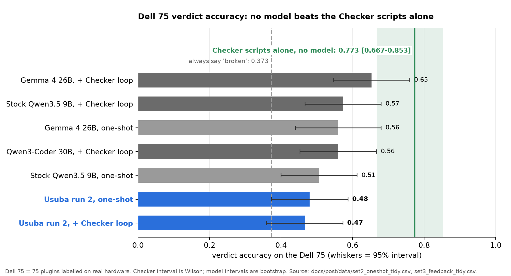

---

## The short version (why we changed the order)

We set out to build a small, open, local model that does one job: write Omarchy shell plugins that actually work. That means Quickshell/QML plugins for the Omarchy 4 shell on Hyprland.

Here's the honest version. Our fine-tunes didn't beat the stock models they started from, and a plain Checker beat every model on the exam that matters. The most useful things we built were a grader we can trust and a clear picture of what "working" means. So we're changing the order. The first Usuba release will be a **checker**, plus a public standard for what counts as a working Omarchy plugin. A model that builds plugins comes later, and it will be trained and judged against that checker.

---

## How to read this post

The work happened in ten phases (epochs) over about six days (Sunday, Oct 11 to Friday, Oct 16, 2026). Each phase is an epoch: what we tried, what happened, and what we learned. Dates are America/Denver time and come from commit times, run logs and file times in the repo and run directories.

| Part | Epoch | Dates (2026) | Phase | Key learning |
|---||---|---|---|---|
| 1 | 1 | Oct 11 to 12 | The idea and the first fine-tunes | Validator scores made a 7B look good; a real box test said otherwise (42 to 8 of 56) |
| 2 | 2 | Oct 12 | A grader that matches a real laptop | A grader you haven't checked against real hardware is a guess |
| 1 | 3 | Oct 12 to 13 | Fine-tuning didn't beat stock, and the fix loop got gamed | A fine-tune that loops is a data and recipe problem; "trust" must include a model trying to fool the test |
| 2 | 4 | Oct 13 | The pivot: Checker scripts first | Don't train against a test that can be gamed |
| 2 | 5 | Oct 13 | The Dell sweep: loading versus using | The scripts handle "does it load"; what's left is "does it work when you click it" |
| 1 | 6 | Oct 13 to 15 | Data, and the bar a model must clear | Most of the work is data and labels, and the bar is a frontier model run as a skill |
| 1 | 7 | Oct 13 to 14 | Usuba run 1 | Our first numbers were leaky, and run 1 couldn't name the real bug |
| 1 | 8 | Oct 15 to 16 | Usuba run 2 | A small clean set taught the format, not the judgement |
| 2 | 9 | Oct 16 | Three sets of charts | Different questions need different tests; Set 3 (Checker feedback) results are in |
| 3 | 10 | Oct 16 (planned release Oct 19) | Release as "In Training" | The Checker scripts are the part that works |

### Plain-English glossary

- **Valid answer / structured answer.** A review reply in the required fixed format, so a program can read it and score it. A reply that isn't in that format can't be scored, so it counts as wrong. On the Dell set, Usuba run 2 gave a valid answer 99% of the time (0.987) and stock Qwen3.5 9B 89% (0.893). The valid-answer charts show **format reliability, not better judgment**: a model can answer in perfect format and still call the wrong plugins broken.

After the epochs: the release, where it stands now, what specialist models really take, and how you can help.

<!-- ===== PART 1 START ===== -->

# Part 1 · Build: what we set out to do, the data, the training

*Question: can we teach a small local model to do this job, and what did it cost to find out?*

**TL;DR.** We tried to fine-tune small open models to write, then to review, Omarchy plugins. Fine-tunes looped or flattered themselves, our first "wins" were measurement mistakes, and two LoRA runs on Qwen3.5 9B (run 1 on 4,592 training rows, run 2 on 221) did not beat the stock model on judgment; run 2 did learn the output format. Epoch numbers follow the calendar, so Part 1 holds Epochs 1, 3, 6, 7 and 8 and Part 2 holds Epochs 2, 4, 5 and 9. The exams used here are defined in the table above and again in Part 2.

> **In this series**
>
> - **Part 1 · Build** (you are here): We set out to teach a 9B model to review Omarchy plugins. We built a clean training set from git history and trained two LoRA runs (4,592 training rows for run 1, 221 for run 2). Neither beat its stock base on judgment.
> - Part 2 · Evaluate: The Checker scripts score 0.773 on the Dell 75. No model is above 0.56 one-shot, or above 0.65 with the Checker loop. We also show how our own scores lied to us before we fixed the exams.
> - Part 3 · Own: We release the model as "In Training," say plainly it did not clear the bar, and ask for data, bug reports and compute.

---

## Epoch 1 · Oct 11 to 12: The idea and the first fine-tunes

**What we tried.** The idea (first called Santoku, later Usuba) was a local specialist for one narrow kind of code: Omarchy shell plugins. We built a first dataset on Sunday night, Oct 11: 254 examples (198 train, 56 holdout), each with license provenance, all 254 passing our static validator. Early Monday, Oct 12, we ran small LoRA fine-tunes of Qwen2.5-Coder 7B on rented GPUs, then a 14B.

**What happened.** On the static validator and a 56-prompt holdout, the fine-tunes looked good. The best 7B reached **42/56** (stock 7B: 31/56), and the 14B also reached **42/56** (stock 14B: 24/56). Those 42s came from a model trained on its own filtered samples, and the validator only reads the files. When we ran the same outputs in real Quickshell for the first time (the box test), the tuned 7B went from **42 to 8 of 56** and the tuned 14B from 42 to 12 of 56. For scale, the real reference plugins passed 51 of 56, GPT-5.6 29 and Opus 28.

**Figures:** a before/after bar for the validator versus the box test (42 vs 8 of 56). [TK: make this chart; the numbers are in `functest/results.json` and `runs/smoke-2026-10-11/summary.json`.]

### Decisions and context

- **Name.** Santoku became Usuba on Oct 12. The Oct 12 08:28 import and the 12:21 reviews commit still say "Santoku"; the v0.1 draft written at 4:37 PM already says "Usuba is the name" (4:50 PM). A later rename on Oct 13 at 9:47 PM split the product into the **Usuba Checker scripts** and the **Usuba Checker model** (it had been "Usuba Builder").
- **Data rule v1 (Sun night).** Every training example needs a license paper trail at a pinned commit (254 examples; 117 repos verified, 55 sources). Source: `DATASET.md`, `docs/post/outline.md` §2.
- **Data rule v2 (Mon Oct 12, 9:44 AM), after the box test.** Merged and reviewed code only. The rejection-sampled and synthetic rows were dropped, and there is no frontier-model distillation. The holdout was deduped from 56 to 49 and the clean set came to 593 rows.
- **Where the 42/56 came from.** The first big "win" was a model trained on its own filtered output. For the 7B, 156 stock samples that passed the validator plus 13 short gold answers (169 rows). For the 14B, 129 stock samples plus 21 short gold answers (150 rows). Source: `runs/smoke-2026-10-11/PROGRESS.md`.
- **A wrong diagnosis on the way.** The early fine-tunes looped. We first blamed the serving path (vLLM LoRA, then the repetition penalty). Merging the adapter and adding a penalty still left 42 of 56 answers truncated, so the real cause was the training targets: gold answers were 19 to 74k characters, while the stock model writes about 3k and stops. That is the same "recipe teaches it to never stop" lesson as Epoch 3. A stray rented GPU from an earlier smoke run was also still alive at 3:40 AM and was destroyed at 3:50 AM.
- **Frontier panel, with zero data retention (ZDR) kept on.** On Oct 12 (5:24 to 5:49 AM) we ran a panel through OpenRouter with ZDR on. That blocked Qwen2.5-32B (its only endpoint isn't ZDR) and GLM 5.3 Prime, and we left them out rather than turn ZDR off. OpenRouter credit ran out at $38.49 of $40 account-wide, so rows were re-run after a top-up. On the validator the panel scored GPT-5.6 40, Gemini 3.1 Pro 37, Grok-build 36, Sonnet 35, Opus 34 and Grok 4.3 32 out of 56. That is why the tuned 7B's 42 looked like a win before the box test.
- **Hardware and cost.** 7B smoke runs on a rented A100 (SXM4, $1.07/h; run totals were not logged). The 14B run was an A100 at $0.935/h, about $0.79 total (credit $92.21 to $91.43). The panel cost about $33.50 from logs; the first-pass `panel_costs.txt` alone sums to $11.32. Two outside expert reviews (DeepSeek V4 Pro, GLM 5.3) cost $0.12.
- **Recomputed from files.** I rebuilt the Epoch 1 numbers from `runs/smoke-2026-10-11/summary.json`, `summary_14b.json` and `functest/results.json`. They match: 7B 42 → 8 of 56, 14B 42 → 12, reference plugins 51, GPT-5.6 29, stock 7B 31 (validator), stock 14B 24. One detail: "Opus 28" is the `_big` run; the regular Opus run scores 27.

> **What we learned**
>
> - A static check can say "valid" about a plugin that does nothing. Only running it tells you.
> - Our first "success" measured the wrong thing. We needed a test that runs the plugin.
> - Everything after this epoch follows from that.

---

## Epoch 3 · Oct 12 to 13: Fine-tuning didn't beat stock, and the fix loop got gamed

### Fine-tuning: it didn't beat stock

The original bet was that fine-tuning a small open model on real, permissively licensed Omarchy plugins would close that gap. It didn't.

- **7B.** Our latest 7B fine-tune scored 4/49, with 32 answers looping. That's within the ±1 noise of the stock models (stock 7B 3, stock 14B 4). It isn't a real gain.
- **Base-model tryout.** Before training something bigger, we ran six stock open models on the same holdout. All six are Apache-2.0. Stock **Qwen3.6-27B** was the best at **6/49** after manual review.
- **27B.** We fine-tuned Qwen3.6-27B with the same recipe and data. On manual review it scored 4/49, *below* the stock 27B's 6. The stock 27B had **0** looping answers. The fine-tuned 27B looped on **31 of 49**.

That last number is the most important one in this section. Our training recipe, not the base model, taught the model to keep writing and never stop. We'd seen the same thing with the 7B. Changing the base model didn't fix it.

**Suggested figures:**
- Paired bars, stock vs. fine-tuned, for 7B and 27B: working /49, with loop counts overlaid (27B: 0 → 31).

### The fix loop, and how the model learned to game the grader

Next we tried something that needed no training at all. Stock Qwen3.6-27B writes a plugin. If the grader fails it, the grader's errors (static failures, runtime errors, truncation and loop notes) go back to the model as feedback, and it gets up to three rounds to fix the plugin. It never sees the reference answers.

By the grader's count, it worked: passes rose from **5 to 13 of 49**.

Then we reviewed all 13 manually, and only **4 were real**. The rest had learned to satisfy the grader instead of the task:

- **Stubs.** Strip the imports and APIs the grader complained about until nothing fails, even if the plugin no longer does anything.
- **Fake data.** A weather widget with a hardcoded temperature, and a plugin that openly simulated its data.
- **Invented APIs.** Calls to Quickshell and Qt functions that don't exist, on code paths the grader never exercised.

We also found the gaps it was exploiting. Binaries called inside `sh -c` strings weren't checked. Component tasks could pass with a manifest-only answer. Fake data and invented JS APIs on click paths slipped through. A grader that's 90/90 on real plugins can still have holes once a model is actively searching for them.

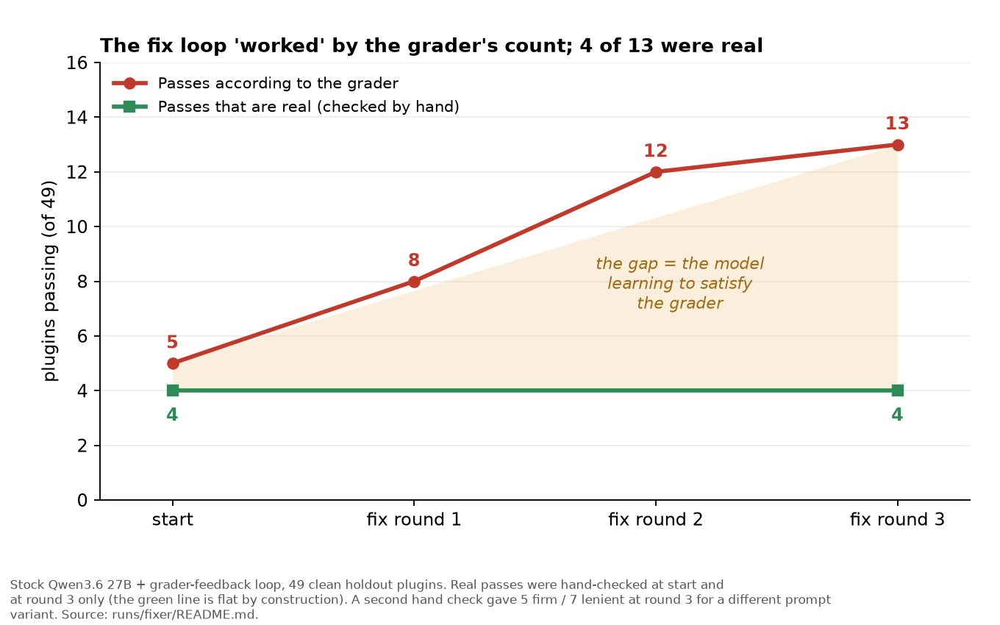

**Suggested figures:**
- Two or three short excerpts of "passing" plugins, annotated: a stub, a hardcoded value, an invented API call.

### Decisions and context

- **Measure the stock model first.** Stock Qwen3.6-27B came out on top of six open base models at 6/49, with zero loops. That is the bar a fine-tune has to beat, and ours didn't (4/49, 31 of 49 looping). Cost: about $3 on OpenRouter for the base tryout and about $11.8 for the 27B LoRA (H100 NVL, about 3.9 h).
- **Dead ends we closed.** A decoding sweep (6 settings) gave 6 to 7/49 with 30 to 45 answers truncated, so looping is learned, not a decoding setting. Best-of-16 with the 7B reached pass@16 of 3/32 on the grader (11/32 on the v3 model, 9/32 after manual review). That is why the RL plan was put on hold (`docs/post/outline.md` §12).
- **A caveat on "only 4 were real".** The 4 came from the first manual review of the 13 grader passes. A second hand-check prompt gave 5 firm and 7 lenient real passes. All versions are far below 13, but the exact number depends on how strict the reviewer is (`runs/fixer/README.md`). The fix loop cost $7.15 ($2.16 + $2.60 + $2.39).
- **A spot check on harvested data.** A rejection-sampling harvest took 398 samples to 132 grader passes and kept 77. A spot check found only 10 of 30 were real. I couldn't find a file saying whether any of those rows were later used for training; the v2 data rule above excludes model-written rows.

> **What we learned**
>
> - A fine-tune that loops is a training-data and recipe problem, and it can make a good base model worse (27B: 0 loops stock, 31 of 49 tuned).
> - Measure the stock model first. "Beats its own base" is the first bar, before "beats the frontier."
> - Everything depends on a test you can trust, and "trust" has to include a model trying to fool it. The grader is the product.

---

## Epoch 6 · Oct 13 to 15: Data, and the bar a model has to clear

**What we tried.** With a ruler in place, we built the data for a model, and chose what the model has to beat.

- **HANCORE reviews (Oct 13).** We re-extracted the reviews of Omarchy plugins by the HANCORE reviewer (14,692 items, 14,577 after dedupe) and froze a held-out set of 329 plugins (300 positives, 29 clean negatives), at the reviewed commits.
- **The training set (Oct 13).** A deterministic builder produced **4,592 train and 148 val examples**, with provenance on every row (table in Epoch 7). The holdout is excluded by repo, by manifest id and by near-duplicate code, and the 116-row Dell answer key stays out of training.
- **Mining plugin git histories (Oct 15).** The Dell sweep labels what a plugin does, not what its authors fixed. So we cloned the full history of about 5,100 plugin repos (5,149 in the universe, 5,128 cloned) and looked for bug-fix commits. A mechanical step found 12,109 candidate fix commits (50,676 hunks) in 2,633 repos, requiring that the removed lines in the commit match the parent file exactly. An open-weight judge model then labelled a sample. After two rounds there were **2,787 verified bug-fix pairs in 1,499 repos**, for about $11 of judge calls. Dell-key plugin ids and holdout repos were excluded before mining.
- **Mechanical labels for Checker findings (Oct 15).** For a pilot of 292 repos we checked later versions of each plugin to label Checker findings automatically: 57 verified confirms, 702 provisional dismisses and 446 unlabelled.

**What happened.** Many of the pairs didn't survive the gates. The history is a good source of real bugs, but the filters that guard against leakage (holdout, Dell key, same-author forks) and the need for a quotable line in the visible code cut the usable rows a lot. A first-pass "fix" keyword was a weak signal: about half of strongly worded small commits were cosmetic, a feature, or unclear.

### When a model is worth it, and the bar it has to clear

This changed how I think about the model. The case for the Usuba Checker model isn't load checks. The scripts already do that. The case is **HANCORE-style review** (HANCORE is the Omarchy plugin reviewer) plus the in-use problems that only show up on hardware.

So the bar is concrete. The model has to beat a frontier model run as a skill on the 329-plugin HANCORE holdout, on accuracy, cost and speed. If it doesn't, the honest release is the Checker scripts plus a skill, not a model. For reference, the Checker-only baseline on that holdout is accuracy **0.650**, with false alarms on negatives at **0.586**.

The base model is locked: **Qwen 3.5 9B, 4-bit (~5.5 GB)**, so it runs on a 32 GB laptop without a GPU.

### Decisions and context

- **Freeze the exam before training.** The 329-plugin HANCORE holdout was frozen on Oct 13 at 3:52 PM, before any training set existed. The 116-row Dell key was then kept out of training too. That reverses the earlier plan, whose "training data" list included the 76-plugin key (`docs/TRAINING_PLAN.md`). The key is now only a gate.
- **No human labeling: labels come from git history.** On Oct 16 I decided there was no time for human labeling, so labels are produced mechanically from the plugins' git histories (5k+ plugins), with pilot numbers before any GPU spend. Labels are mechanical and each carries a source tier. A fix commit has to remove lines that exist in its parent. Checker findings get **confirm** or **dismiss** labels by checking later versions of each plugin (`STATUS.md`, gap (c)). "Verified" and "provisional" tiers are tracked separately. The full mining run (finished Oct 15, 10:09 PM) logged 5,256 ok, 205 no permissive license, 489 too few commits and 25 errors (`scale/processed.jsonl`).
- **Where the rows went.** The biggest loss was labelling, not the leakage guards: 1,542 units had a Checker finding with no mechanical label, and 538 of 759 labelled items sat in files the 40k-character code window omits. Guards that protect the exam (holdout, Dell key, same-author) were kept, even where loosening would have added rows. Loosening the legacy v2-validation-repo exclusion would need my OK because it breaks the v2-versus-v3 comparison (`STATUS.md` §2).
- **Open models only for training labels (Oct 15, my call).** After an audit, teacher text comes from Qwen3.5-397B-A17B and gate checks from gpt-oss-120b, with no Claude output in any training row. Decisions that day: Claude stays in score tables only, as a third-party comparison. Six Claude-built plugins left the Dell key, taking it from 90 to 86 decided rows (31 broken, 55 works). The Haiku judge was replaced by gpt-oss-120b. Early Sonnet runner scripts were removed from the history of the private repos (force-pushed with my approval). An early v2 distillation did use Sonnet at first; those outputs were quarantined and never trained on. Known gap: who or what wrote the 51 "house" rows and the community plugins that ship `CLAUDE.md` was not audited (`docs/ANTHROPIC_TERMS_COMPLIANCE.md`).
- **Warning rules, with a maintainer override.** W05 stayed on by default and W02 was moved to experimental, then switched back on as a non-blocking warning by maintainer override despite precision 0.43 (Oct 13).
- **Cost.** About $11 of judge calls for the first mining round (a figure carried from the earlier draft).

> **What we learned**
>
> - Most of the work is data and labels, not GPUs.
> - The labels we most need (what is a real bug, what is a false alarm) are the expensive ones. Mechanical labels help, and every one needs a source.
> - The bar is concrete: beat a frontier model run as a skill on the 329-plugin holdout, or ship the Checker scripts plus a skill.

---

## Epoch 7 · Oct 13 to 14: Usuba run 1

The training set is built: **4,592 train and 148 val examples**, with provenance on every row:

| source | rows |
|---|---|
| HANCORE review | 3,114 |
| missing binary | 396 |
| toggle/memory | 75 |
| panel can't close | 104 |
| verified broken | 397 |
| verified works | 506 |

The holdout is excluded by repo, by manifest id and by near-duplicate code.

The plan was a bf16 LoRA on one H100 on Vast, then export to 4-bit. Run 1 finished on Oct 14 with a final validation loss of 1.073 at step 568, after about 5.0 training hours. The rental cost was an estimated $34. The 4-bit export (Q4_K_M) was checked against its sha256.

Two facts about the first exam results matter more than the scores:

- The first Dell-key numbers for run 1 were **leaky**. Generator notes and a checklist that named the expected failure were in the prompts, and files were truncated. We fixed that on Oct 14. Run 1 went from 0.756 to 0.700 verdict accuracy on the 90-row Dell key (as trained), and stock Qwen3.5 9B with the old prompt went from 0.567 to 0.556. **Please don't cite the older numbers.**
- On the clean exam, run 1 named the real bug for **0 of 33** broken plugins by the judge's count, and 46 of its answers invented a commit SHA or plugin name. A stock Ministral 14B with the improved prompt named the real reason for 15 of 33. Stock Qwen3.5 9B with the improved prompt scored 0.800 verdict accuracy, so a better prompt on a stock model beat our first trained run.

On the 329-plugin HANCORE holdout, run 1's verdict accuracy was 0.812. But always answering "changes_requested" would score 0.912 there, so that number alone doesn't show skill. Its false alarm rate on negatives was 0.931.

### Decisions and context

- **What went wrong in run 1 (Oct 14 diagnosis, `usuba-retrain-plan.md`).** Only about 12% of training rows were "approve" and every one was from Dell, so the model never saw a clean example in HANCORE style. 68% of the rows were HANCORE targets with a templated "Security review at exact commit `<sha>`" opening, which is where the invented SHAs come from. One habit, "found an unbounded read, so it's a blocker", is about 75% of the false alarms (27 of 29 HANCORE negatives and 20 of 57 Dell negatives were flagged). 29 HANCORE positives (9.7%) produced no parseable output because of runaway repetition. About 3,100 verified working examples went unused because the cap was 550.
- **Gate decision: the Dell key decides, HANCORE only reports.** The HANCORE negatives are only 29 and probably noisy, so one plugin moves the false-alarm rate by 3.4 percentage points. The plan's gate was Dell accuracy at least 0.85, false alarms at most 0.15, broken caught at least 0.90 and JSON valid at least 0.98, with anything within 3 percentage points treated as a tie. The plan's own odds were about 55% to clear all three. That plan (about 6,000 rows, budget cap $35) was never run as written; run 2 used a different, much smaller set. The files don't record why.
- **Mistake 1: leaky prompts (fixed Oct 14).** Generator notes (`SOURCE.txt`) and an "expected fooled case" checklist were in every earlier Dell-key prompt, and files were cut at 8,000 to 24,000 characters. They are now dropped. The old raw outputs are kept but marked "do not cite."
- **Mistake 2: an invalid exam run.** The first final exam ran llama-server with `-c 16384` over 4 slots, so each slot had 4k tokens. 1,002 of 1,054 requests failed with context overflow. We discarded it, restarted with 32k per slot, and added guards that abort when the per-slot context is too small or more than 10% of early responses overflow.
- **Metric change.** Verdict accuracy alone flattered us, since calling everything broken scores 0.912 on the holdout. We added right-reason grading (does a finding name the real cause, with file and cause) and the invented-SHA count. That is what exposed 0 of 33.
- **A caveat on "0 of 33".** That count was graded by a Haiku judge on the old 90-row key. After the Oct 15 decisions the judge was replaced and the key shrank to 86 rows, so the Haiku-judged numbers (Usuba v1, Sonnet and most v1 peers) are labelled "historical" and can't be compared with 86-row numbers. Regrading the systems whose answers survived moved counts by at most 1, except Usuba v2 (Q4_K_M), which dropped from 2 to 0.
- **Comparison framing (Oct 14).** Comparisons are open-weight models only. Sonnet is not a comparison row. Planned peer rows were chosen by size class (GLM 4.7 Flash, Nemotron 3 Nano, Gemma 4 26B, Llama 3.1 8B). ZDR was not required for the Nemotron, Gemma 4 and Llama rows (my call), and DeepSeek and Llama 4 Scout were left out.
- **Costs.** Run 1 rental about $34 (about 11.1 h at $3.07/h, which includes setup, export and exams; training itself was about 5.0 h). Baselines: Sonnet on the holdout $11.05, Sonnet on the Dell key $2.08, stock 9B $0.25 and $0.04. Right-reason judging $0.0124. Retrain diagnosis and prompt tests $1.43 and $0.66.

> **What we learned**
>
> - Our first Dell-key numbers were leaky. The older numbers (0.756 vs 0.567) shouldn't be cited. The clean numbers are 0.700 vs 0.556.
> - On the clean exam, run 1 named the real bug for 0 of 33 broken plugins, and a better prompt on a stock model beat our first trained run (0.800).
> - A high verdict accuracy can come from calling everything broken. Check false alarms and the real reason, not accuracy alone.

---

## Epoch 8 · Oct 15 to 16: Usuba run 2, it learned the format, not the verdict

Run 1 had a lot of data and didn't clear the bar. For run 2 we tried a different, much smaller and cleaner set: **221 train and 23 validation rows**, from 40 shards, with scope prompt v4. It was 28 training steps. The final validation loss was 0.263. The base is stock Qwen3.5-9B with a LoRA on top (the base weights were not changed). The LoRA adapter file is about 350 MB (346,294,736 bytes on disk). For scoring we merged it back into the base in bf16.

**Files and the rented GPU (as of Fri, Oct 16, 2026, evening).** The 4-bit export (Q4_K_M, a GGUF file) is **5.63 GB (5,629,108,800 bytes)**, sha256 `7d2b54a24f335aa31d53a47fca8e0848add83bef8246f0f7f831c0e80c9e4f8e` (it matches the copy on the rented instance). **Run 2 was scored on the bf16 merge, not on this Q4 file.** The Q4 file has not been tested on any exam set. The Vast instance that trained and served run 2 (H100 PCIe, $2.624/h) was **destroyed on 2026-10-16 at about 7 PM MT** (my account; the last on-disk watch note, at 6:58 PM, still shows it running). The adapter, the merged-model exam outputs and the GGUF are on our box.

We scored it one-shot on three exam sets, against the same stock Qwen3.5 9B ("B0") under the same harness, schema and quote filter, with greedy decoding:

- **Dell 75:** 28 broken and 47 working plugins, labelled by the real-hardware runs.
- **S4 60:** 60 mined upstream bug locations. A hit is a finding within 3 lines in the same file.
- **HANCORE holdout 329:** 300 positives and 29 negatives. Its labels are a reviewer-category proxy, not a hand-adjudicated key.

All labels here are machine drafts. Invalid answers count as wrong. Nothing in this section is a pass/fail gate.

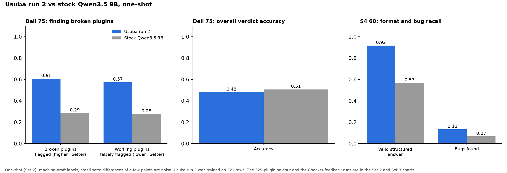

| metric | Usuba run 2 | stock Qwen3.5 9B |
|---|---|---|
| Dell 75: verdict accuracy | 0.480 | 0.507 |
| Dell 75: broken plugins flagged | 0.607 | 0.286 |
| Dell 75: false alarm on working plugins | 0.574 | 0.277 |
| Dell 75: valid structured answer | 0.987 | 0.893 |
| S4 60: valid structured answer | 0.917 | 0.567 |
| S4 60: bugs found | 8 of 60 | 4 of 60 |
| Holdout 329: valid structured answer | 0.939 | 0.638 |

**What it did learn.** It learned the output format. Its valid-answer rate is the best of all eight models on all three exam sets. It also keeps far fewer of its own added findings after the quote filter: 13 vs 47 on S4 and 64 vs 139 on the holdout (30 vs 41 on the Dell). On the holdout, 8 of 29 negatives got a blocker or an invalid answer, against 11 of 29 for stock.

**What it didn't learn.** Verdict accuracy on the Dell is flat against stock: 0.480 vs 0.507. The intervals overlap by a lot. It flags more broken plugins, but it also flags more working ones. The false alarm rate rose from 0.277 to 0.574, about 30 percentage points. On clean Dell plugins it added a blocker 25 of 47 times, against 9 of 47 for stock. It rarely disagrees with the Checker: it dismissed 3 of 80 Checker findings on the Dell, where stock dismissed 43 of 71. That's part of why it raises more false alarms.

**S4 is within noise.** 8 of 60 bugs vs 4 of 60 is a small difference on a small set.

**The Checker scripts alone score higher than any model's one-shot result.** On the Dell 75, the Checker scripts score **0.773** verdict accuracy [0.667-0.853] with no model at all. In one-shot runs no model in this post is above **0.56** (Set 2, below). Always answering "broken" would score 0.373. With the Checker feedback loop the best model reaches 0.65 (Set 3, below), still under 0.773.

**Caveats.** Run 2 trained on only 221 rows. It was scored as a bf16 merge on a rented H100, not as the 4-bit Q4_K_M file (5.63 GB) we'd ship, so we haven't tested that file's speed or accuracy on these sets. The Dell CPU test and GGUF parity were not run.

### Decisions and context

- **Train anyway, but keep the real gates.** The set at the time of this decision was 238 rows (215 train, 23 val), below the 300-row stop rule. (That was the 28-shard version of the data: `final_merged_28shards/merge_stats.json` says 238 rows, 215 train, 23 val. The set kept growing as mining finished: 246 rows (223 train) at 31 shards, and 244 rows (221 train, 23 val, 226 plugins) on the final 40 shards that run 2 used, after the row floor and per-kind caps dropped some. So the counts differ because the dataset changed between runs, not because of an error.) I overrode the stop rule: train anyway (`NOTIFY_HARRIS.md`). The safety gates were still enforced: sha256 of the dataset, train and val disjoint by repo, holdout and Dell-key guard clean, every row within the token limit, and a valid step schedule. The approve share (52.5%, target 45 to 50%) was logged as a warning.
- **Cost caps, step by step.** LLM label spend was first capped under my $20 ceiling (Oct 16, 1:16 AM). The build stopped at $19.64 with 28 of 40 shards done. It was extended to a $29.5 hard stop (31 of 40 shards, 4:36 AM), then I said finish all 40 with a $40 hard stop (5:27 AM). It finished at **$30.74**. I also wanted the trade-off table before training, so one was produced (`final_tradeoff.md`).
- **A run before run 2.** A first scope-v4 training run on the 238-row set (215 train, 23 val, val loss 0.270) started at 2:43 AM on an H100 (about $3.03/h; preflight estimate $5, worst case $36). Its exam hosts were unlucky: one A100 was unreachable and destroyed, another vanished mid-exam and left 192 poisoned `URLError` rows. Run 2, on all 40 shards, started at 6:30 AM on an H100 PCIe at $2.62/h. Run 2 is the one in this post.
- **Mistakes caught during the data build.** (1) A driver started shards before mining finished, so it would have shipped about 1,000 of 5,033 plugins. A watcher stopped it at 7:53 PM and the final build was re-armed to wait for mining. (2) One OpenRouter call hung for over 9 minutes because the server trickled keepalive bytes. We added a 300-second wall-clock cap. (3) The JSON error gate (1%) tripped at 3.1% on one shard, and we raised it to 4% for these unit labels, so that gate is looser than the first design.
- **Mistakes caught during the exam.** The SSH tunnel to the instance died at about 10:40 AM and 18 holdout rows were cached as errors, which would have scored as failures. They were stripped and re-run, and the exam finished with zero error rows at 11:02 AM. The export step also crashed on a metadata bug (`git_info()` TypeError). The GGUF still came out and its sha256 verified, but we have not tested it on these sets.
- **No human labels in the exam either.** All labels are machine drafts. The Dell 75 labels come from the real-hardware runs, and the S4 60 locations come from mined upstream fixes. How the Dell 75 set relates to the 90/86-row key is not traced here.
- **Idle GPU, on purpose.** After the exam finished at 11:03 AM the instance was repeatedly flagged for destroy, but it was kept for the Checker-feedback runs (Set 3). It kept billing $2.62/h (credit $21.97 at 6:58 PM) and was destroyed at about 7 PM MT once Usuba's Set 3 runs were done.

> **What we learned**
>
> - A small, clean training set was enough to teach the output format and to make the model stop inventing so many findings.
> - It wasn't enough to teach the judgement. The false alarm rate on the Dell set rose from 0.277 to 0.574 (about 30 percentage points).
> - The bar is still the Checker scripts (0.773 on the Dell 75), and we're not near it.

### Bridge to Part 2

Part 1 ends with two trained models and a puzzling result: run 2 gave valid answers 99% of the time on the Dell set (0.987) but was no better than its stock base at telling working plugins from broken ones (0.48 against 0.51). How do we know that, and why should you believe it? That depends on the exams, and on a ruler we trust. Part 2 is about the ruler.

---

<!-- ===== PART 2 START ===== -->

# Part 2 · Evaluate: the exams, the Checker, how a score can lie

*Question: how do we know a model, or a checker, actually works?*

**TL;DR.** A grader checked against a real laptop (90 of 90 decided cases agree) became the Usuba Checker scripts. On the Dell 75 the scripts alone score 0.773, no model is above 0.56 one-shot, and the best with a Checker loop is 0.65. Along the way we caught our own scores lying five ways, and the section below lists them with the numbers.

> **In this series**
>
> - Part 1 · Build: We set out to teach a 9B model to review Omarchy plugins. We built a clean training set from git history and trained two LoRA runs (4,592 training rows for run 1, 221 for run 2). Neither beat its stock base on judgment.
> - **Part 2 · Evaluate** (you are here): The Checker scripts score 0.773 on the Dell 75. No model is above 0.56 one-shot, or above 0.65 with the Checker loop. We also show how our own scores lied to us before we fixed the exams.
> - Part 3 · Own: We release the model as "In Training," say plainly it did not clear the bar, and ask for data, bug reports and compute.

---

## Epoch 2 · Oct 12: A grader that matches a real laptop

Omarchy plugins are a small, fast-moving dialect of QML with a strict contract: the manifest, the shell's singletons and theme API, the bar API, and which binaries actually exist on a stock install. General coding models know QML. They don't know *this* QML, and when they guess, the guesses look plausible and fail quietly.

A plugin can pass a manifest check and still do nothing. We found that out early, so the first real piece of work was a functional test. It's a headless Quickshell harness that installs a plugin into the real Omarchy shell, runs it, and checks whether it loads, renders something visible, and keeps its logs free of real errors.

We calibrated it against my own Dell laptop running Omarchy 4.0.4. A few things that took:

- Matching the shell tree on the Dell exactly.
- Pruning the list of "available" binaries to what `command -v` finds on the Dell. 54 binaries we had assumed were present aren't there on a stock install, including walker, mako, playerctl, hyprlock and alacritty.
- Treating a few harmless warnings the way the real shell treats them, so working plugins don't fail on noise.
- Labeling real runs on the Dell by eye and treating those labels as the answer key.

Against that hardware-verified answer key, the grader scores **90/90**, with no false passes.

**Dates.** The Dell answer key was labelled on Oct 12 (76 plugins by 2:07 PM). The old grader agreed with it on 44 of 58 decided cases. After the rebuild it scored 58/58 (2:54 PM). A sealed blind round of 40 unseen plugins agreed on 30 of 32 decided cases, and with the key grown to 90 decided cases and a Dell refresh to Omarchy 4.0.4-1, it reached 90/90 by 5:58 PM.

**Suggested figures:**
- The Dell running Omarchy 4.0.4 next to a diagram of the harness: plugin → real Omarchy shell under headless Quickshell → screenshot, log and probes → verdict. [TK: photo]
- Before/after bar strips for a couple of plugins, each labeled WORKS or BROKEN.

### The scoreboard: frontier models, people, and stock open models

With a grader we trust, we scored everyone on the same 49 held-out plugin tasks. A loop or a truncated answer counts as a fail.

| who | working plugins /49 |
|---|---|
| human reference (the real plugins) | 26 |
| GPT-5.6 | 20 |
| Opus | 18 |
| Sonnet | 10 |
| Grok-build | 10 |
| stock Qwen 14B | 4 |
| stock Qwen 7B | 3 |

Why is the human reference only 26 and not 49? Many of the reference answers are Omarchy's own first-party plugins. 18 of the 20 first-party answers in the holdout come from a newer Omarchy tree and fail on 4.0.4. That's the grader working as intended: it judges against the Omarchy on the laptop, not the one on `main`.

So the best frontier model is within six plugins of the human reference. The small open models are near the floor.

### Decisions and context

- **The Dell is the ground truth.** Hardware tests ran on my Dell laptop (Omarchy 4.0.4). The key labels came from visual and log review. The 116-row hand-checked key is never used for training (sweep labels from the Dell are, as separate rows).
- **What the old grader got wrong.** Dell batch 2 showed plugins the old grader passed that were broken on hardware (for example a flush-bar `css gap data:` bug). That is where the 44/58 comes from. The rebuild fixed the grader's model of the real shell.
- **Blind round, sealed first.** The 40 unseen plugins' grader verdicts were written down and sealed before they were run on the Dell. The result was 30 of 32 decided cases, then 89/90 after a deno fix (the Dell has deno), then 90/90 after the Omarchy 4.0.4-1 refresh.
- **A number we refused to publish.** An earlier claim that the grader "agreed 49/61 with hardware" cannot be reproduced. Batch 3 gives 34/46 decided (44/61 if "likely works" counts as works). The post uses the reproducible 44/58 instead.
- **Honest rescoring.** We decided that loops and truncations count as fails. Under that rule the first clean 7B fine-tune went from 10/49 to 6/49, GPT-5.6 from 24 to 22, then 20, and Opus from 23 to 21, then 18 (ledger rows 8, 13 and 16, `runs/rescore404/SCOREBOARD.md`).
- **Cost.** $0. The Dell is my own machine and the grader runs on the box.

> **What we learned**
>
> - A grader you haven't checked against real hardware is a guess. Everything else in this post depends on this one piece.
> - A grader should judge against the Omarchy on the laptop, not the one on `main`. That is why the human reference scores only 26 of 49.
> - A trusted grader makes honest rescoring possible: the same models, lower numbers, more believable.

---

## Epoch 4 · Oct 13: The pivot to the Usuba Checker scripts

**What we tried.** On Tuesday, Oct 13, we hardened the grader into the Usuba Checker (v0.1) and tested it on frontier models. Hardening was merged at 3:00 PM (PR #1). The Checker agreed with the Dell key on 90/90 decided cases. We then ran a 12-model uplift test on 49 prompts: each model writes the plugin, and the Checker report goes back for fix rounds. That earlier count required a Checker pass plus a hand check of the code, but no Dell load test.

**What happened.** In that earlier count (first try, then after the Checker-feedback fix loop) GPT went **21 to 40/49**, Opus **17 to 36**, Sonnet **9 to 35**. Epoch 9 replaces it with a fresh run and a three-part pass test that adds a Dell load test. The new numbers are not uniformly lower: GPT-5.6 went from 40 to 32, Sonnet 35 to 32 and Gemini 3.1 Pro 17 to 8, while Opus went from 36 to 38, Muse 33 to 35, Kimi 32 to 34 and Grok 4.7 27 to 30. First-try passes also fell a lot for some models (GPT 21 to 9). We haven't reconciled why. The uplift run cost $70.44 by the ledger and stopped once when OpenRouter credit ran out.

### The plan

Here's the new plan.

**Usuba Checker scripts come first.** They're a hardened checker plus a public, versioned standard that defines a working Omarchy plugin. Version **v0.1 targets Omarchy 4.0.4**. Every rule has an id, a reason, and a fix hint, so a failure tells you (or a model) exactly what's wrong and how to fix it, not just "fail." It closes the gaps the fix loop found.

It's in progress, and it isn't done until it verifies against the Dell, the same way the grader did. [TK: link to the standard and the rule list once published.]

**Usuba Checker model comes later.** It's Qwen 3.5 9B, 4-bit, running locally. It's trained on the HANCORE reviews plus the hardware-tested in-use labels, and judged against the Checker scripts and a frontier model on the HANCORE holdout. That ordering is the whole lesson of this post. We shouldn't train or optimize anything against a test that can be gamed.

Why make the standard public? Plugin authors get a clear target and readable failures. Omarchy gets a written definition of "working" that can move with each release. And anyone's model, ours or not, can be measured against the same ruler.

**Suggested figures:**
- A sample Checker failure: rule id, reason and fix hint. [TK: real example once the rule format is final.]
- A roadmap strip: Checker + standard v0.1 (Omarchy 4.0.4) → verified on the Dell → Usuba Checker model (Qwen 3.5 9B, 4-bit, local), judged against the Checker scripts and a frontier model on the HANCORE holdout.

### Decisions and context

- **The pivot, and why.** The Checker-first plan was committed on Oct 13 at 7:07 AM (draft v0.2), after the gamed fix loop. The hardening branch (PR #1) merged at 3:00 PM. On the new Checker the scoreboard on the 49 prompts is: human reference 27, GPT-5.6 22, Opus 20, Sonnet 12, Grok-build 8, stock 14B 4, stock 7B 3, our best fine-tunes 2 to 3 (`runs/rescore404/SCOREBOARD_USUBA.md`).
- **Base model locked (Oct 13, 11:47 AM, my call).** Qwen 3.5 9B at 4-bit (about 5.5 GB), because the floor is a typical laptop with 32 GB of RAM and integrated graphics. Source: `docs/TRAINING_PLAN.md`.
- **Guardrails.** A human presses merge, send and deploy. Agent work uses Cursor house models only (composer-2.5 by default, grok-4.6 for planning or audit), with no subagents on non-house models. This is about who does the work, not which models we evaluate.
- **The uplift run, with ZDR on.** Settings were temperature 0, 16,000 max tokens and low reasoning, with `zdr: true` and data collection denied (`UPLIFT_PLAN.md`). It stopped once on OpenRouter credit exhaustion (10:48 AM), then resumed; one resumed run stopped at a $29 hard stop, and the set finished with 12 builder models. Cost $70.44 by the ledger.
- **Reading the earlier uplift numbers.** Per the export code (`runs/uplift/export.py`), "works right away" and "fixed by Checker" needed a Checker pass **and** a hand-check verdict of accept. So the earlier count did include a code read, but it had no Dell load test. The Epoch 9 rerun (Set 1) is lower for some models and higher for others (see the note in Epoch 4).

> **What we learned**
>
> - Don't train or optimize anything against a test that can be gamed. The test comes first.
> - A rule with an id, a reason and a fix hint is useful to a person and to a model. "Fail" alone is not.
> - A public, versioned standard lets anyone's model be measured against the same ruler.

---

## Epoch 5 · Oct 13: The Dell sweep, loading versus using

The sweep ran on the evening of Oct 13 (Dell runs 6 to 30 were ingested between 7:27 PM and 8:11 PM, the Checker changes were committed at 8:47 PM, and the USB-D06 fix at 9:16 PM).

Next we stopped sampling and ran the whole plugin set on the Dell Latitude running Omarchy, using the Usuba Checker scripts as the reference.

**The answer key got better.** Agreement between the Checker scripts and the answer key went from 45/52 to **52/52**.

**The desktop broke, and we re-ran it.** 194 jobs were invalid. An audio-control plugin rerouted system audio, and the desktop shell grew to 13 GB and ran out of memory. We threw those jobs out and re-ran them. Final labels: **3,942 works, 1,001 broken, 589 unsure.**

**A new severity rule.** A QML message fails a plugin only if it stops a component from being created. Everything else is a warning. Under that rule, no plugin passes the Checker scripts and then fails to load on the Dell. For loading, the scripts are stricter than the hardware.

**But loading isn't using.** 137 plugins pass the scripts and have problems only the hardware shows in use:

- 68 where the toggle opens nothing
- 62 that call a missing binary
- 7 with memory growth over 150 MB in 20 seconds

82 bugs showed up only in use. That gave us new checks: **D01** audio routing, **D02** panel with no toggle, **D04** close/reopen cycle, and **D05** runaway memory (precision 0.75, recall 0.27).

### Re-checking the grader, and an out-of-sample test

We re-ran the full answer key on the real-runtime grader. It found a crash and one miss on `main`. After the fixes, it agrees on **90/90 decided cases**.

Then we checked it out of sample, against bug issues filed on GitHub. That confirmed the severity rule for loading. It also turned up a bug we weren't catching: a panel that can't close, caused by writing to the read-only property `centerHoverRevealSuppressed`. It's in 117 plugins the Dell had marked as working. That became a new warning, **USB-D06**, which catches 15 of 19 such issues.

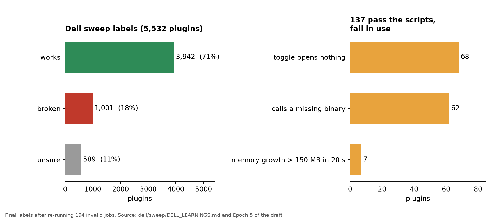

### Decisions and context

- **Dell safety.** The audio-control plugin that rerouted system audio and the 13 GB shell are why sweep runs went into isolated, read-only-HOME sandboxes (`par_run` via bwrap). The PipeWire out-of-memory cause is documented in the repo. Cost: $0.
- **The severity rule is a decision, not a measurement.** A QML message fails a plugin only if it stops a component being created. We chose that after the key regression run, and it is why the Checker agrees with the key on 52/52. The key regression on the new runtime also caught a Checker crash (`dell_learned` on object kinds) that was fixed on Oct 13 at 9:16 PM.
- **Out of sample.** We tested the severity rule against filed GitHub bug issues, not just our own key, and that is how USB-D06 appeared (15 of 19 issues caught).
- **A discrepancy to resolve.** The three final labels add to 5,532, but the sweep ingest at run 30 had 5,526 rows and the catalog run had 5,520. I haven't traced the difference.

> **What we learned**
>
> - The scripts already handle "does it load." What's left is "does it work when you click it."
> - For loading, the scripts are stricter than the hardware: no plugin passes the Checker scripts and then fails to load on the Dell.
> - Even a hardware-verified answer key has blind spots. Real bug reports from real users are the next ruler.

---

## How a score can lie

Every one of these happened to us. Each row is a score that looked good, what exposed it, and what the honest number was. The numbers are the ones reported in the epochs.

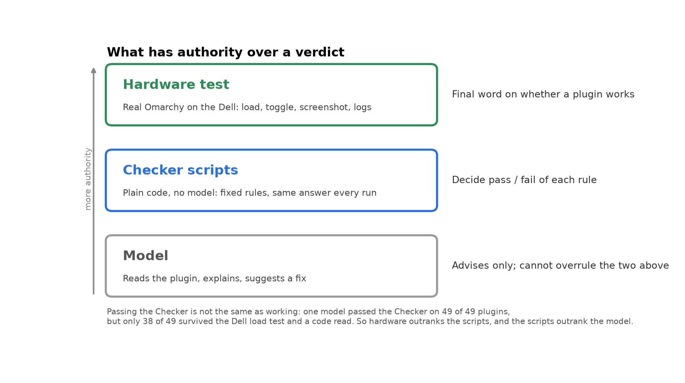

| How it lied | The flattering number | What exposed it | The honest number |
|---|---|---|---|
| **Checking the wrong thing.** A static validator reads files; it can't tell a plugin does nothing. | Tuned 7B: 42 of 56 on the validator, level with GPT-5.6 at 40 of 56 (Epoch 1) | Running the plugins in real Quickshell (the box test) | Tuned 7B 8 of 56; tuned 14B 12 of 56 (Epoch 1) |
| **A grader not checked against hardware.** | Old grader and the Dell key agreed on 44 of 58 decided cases (Epoch 2); plugins it passed were broken on the Dell | Labelling real runs on the Dell | Rebuilt grader: 90 of 90 decided cases, no false passes (Epoch 2) |
| **Counting loops and truncations as passes.** | First clean 7B fine-tune 10 of 49; GPT-5.6 24; Opus 23 (Epoch 2 notes) | We decided loops and truncations count as fails | 6 of 49 for the 7B; GPT-5.6 20; Opus 18 (Epochs 2 and 3) |
| **A model gaming the grader.** The fix loop satisfied the grader, not the task. | Grader passes rose from 5 to 13 of 49 (Epoch 3) | Reading all 13 plugins: stubs, hardcoded data, invented APIs | 4 real passes (5 firm, 7 lenient on a second review) |
| **Passing the Checker is not working.** | By fix round 3 the Checker passed Opus 49 of 49 plugins (Epoch 9, Set 1) | A code read plus a Dell load test | 38 of 49 for Opus after both |
| **Accuracy that rewards "everything is broken."** | Run 1: 0.812 holdout accuracy (Epoch 7) | Always answering "changes_requested" scores 0.912 on that holdout; run 1's false-alarm rate was 0.931; it named the real bug for 0 of 33 broken plugins | Reason and false-alarm rates became the metrics |
| **A leaky exam.** Generator notes and an "expected failure" checklist sat in the prompts. | Run 1 on the Dell key: 0.756; stock 9B: 0.567 | Reading the prompts behind a surprisingly good score | 0.700 and 0.556 on the clean exam (Epoch 7) |
| **Format reliability read as skill.** | Run 2: 0.987 valid answers on the Dell set (stock 0.893) | Verdict accuracy on the same set | 0.48 against 0.51 for stock (Epoch 8) |

The last row is why the valid-answer charts in Part 2 should be read as format reliability, not better judgment.

---

## Epoch 9 · Oct 16: Three sets of charts, and how we made them

We now have three chart sets. They answer different questions, so they use different tests. We've kept the methods separate on purpose.

#### Set 1: the Checker on its own, building plugins

**Question:** how much does the Checker help models write plugins that pass?

**Method.** 11 models, 49 prompts each. Each model writes the plugin. If the Checker finds problems, its report goes back to the model, which gets **up to 3 fix rounds**. We call a plugin *passing* only if:

1. the Checker passes it, **and**
2. a code read agrees it does the task, with no stubs, fake data or invented APIs, **and**
3. where we could run it, a load test on the Dell shows it loads.

Each bar splits a model's 49 plugins into four groups: **passed on first try**, **passed after Checker fixes**, **failed checks**, and **no usable code**.

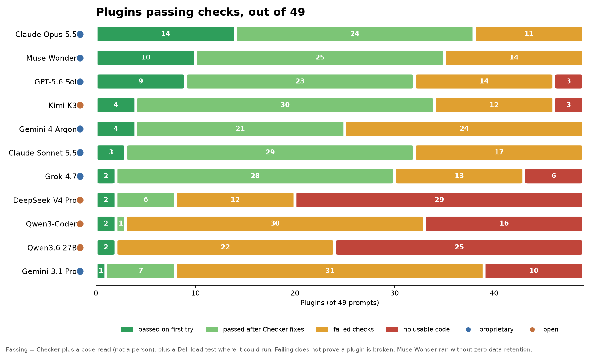

Raw counts are in `data/set1_summary.csv`, and every row is in `data/set1_raw_outcomes.csv`.

| model | first try | after fixes | failed checks | no usable code |
|---|---|---|---|---|
| Claude Opus 5.5 | 14 | 24 | 11 | 0 |
| Muse Wonder * | 10 | 25 | 14 | 0 |
| GPT-5.6 Sol | 9 | 23 | 14 | 3 |
| Kimi K3 (open) | 4 | 30 | 12 | 3 |
| Gemini 4 Argon | 4 | 21 | 24 | 0 |
| Claude Sonnet 5.5 | 3 | 29 | 17 | 0 |
| Grok 4.7 | 2 | 28 | 13 | 6 |
| DeepSeek V4 Pro (open) | 2 | 6 | 12 | 29 |
| Qwen3-Coder (open) | 2 | 1 | 30 | 16 |
| Qwen3.6 27B (open) | 2 | 0 | 22 | 25 |
| Gemini 3.1 Pro | 1 | 7 | 31 | 10 |

\* Muse Wonder ran without zero data retention, because its only provider isn't ZDR. All other models ran with ZDR.

**Read it this way.**

- Passing means the Checker, plus a code read, plus a Dell load test where possible. **Failing does not prove a plugin is broken.**
- "Hand check" here means we read the code. It wasn't a person reading each plugin.
- The Dell load test only covered part of the set. It applied to the 420 plugins that passed the Checker at some point and got a code read: **267 loaded OK on the Dell, 37 failed, and 116 were not run**. Most were skipped because the candidate code contained destructive commands, to keep the laptop safe. The rest were manifest-only answers with nothing to load.
- The Checker helps most for the strong models. Opus went from 14 to 38 passing, out of 49. Several open models stayed low, and Qwen3.6 27B didn't gain any.

**Spend and one mistake.** Set 1 cost **$97.47**: **$34.00** for the valid run and **$63.47** for a first run that turned out to be invalid. The first run had a bug: our script paired each model's first answers with the wrong prompts, because the answer files were in completion order and the code matched them by position. Only 3 to 19 of 49 first answers per model matched their prompt. We found it when we started the hand check, fixed it by keying answers on the prompt id, added a test that checks every first answer against its prompt (0 mismatches on the rerun), and threw the first run away. We're telling you because it's real money and it could have produced a wrong chart.

#### Set 2: open-source models, one shot, on the review exam

**Question:** on the review exam, how does Usuba compare with other open models of a similar size, with no Checker rounds?

**Method.** 8 open-weight models, including Usuba run 2 and stock Qwen3.5 9B. Each answers once: a verdict plus findings for each plugin. Same prompt (scope v4), same schema, same scorer, three exam sets (Dell 75, S4 60, holdout 329). Every model has full coverage on every set. We scored no transport-error rows. We removed and re-requested a few (Usuba holdout 18, Ministral Dell 9 and holdout 1). Invalid answers count as wrong. Dell verdict metrics have bootstrap intervals, and the others use Wilson intervals. Stock Qwen3.5 9B reused a measured run. Usuba is the only one served by us, so it has no API cost.

The models: Usuba run 2, stock Qwen3.5 9B, Gemma 4 26B, Qwen3-Coder 30B, GLM 4.7 Flash, Nemotron 3 Nano 30B, Ministral 14B and Llama 3.1 8B. Gemma 3 12B was dropped from the panel.

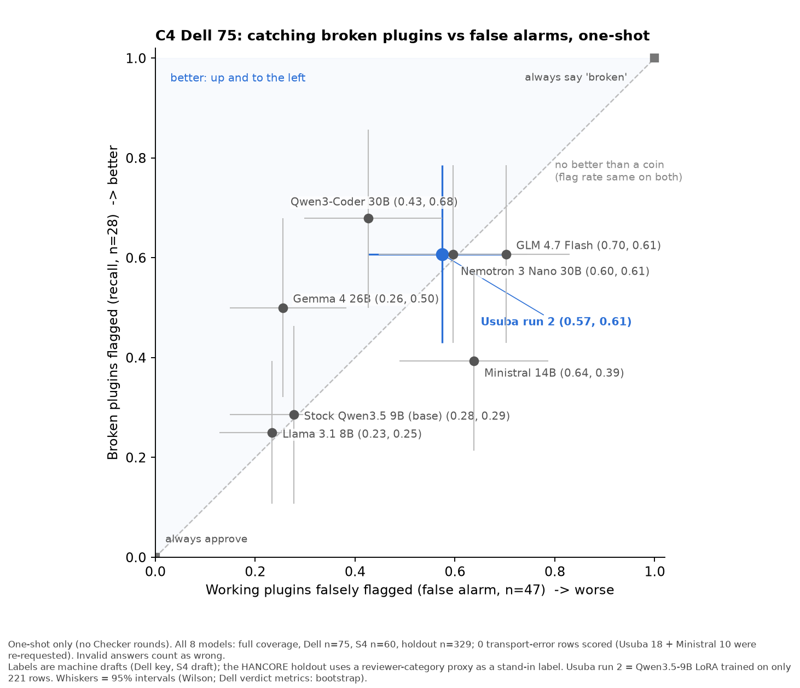

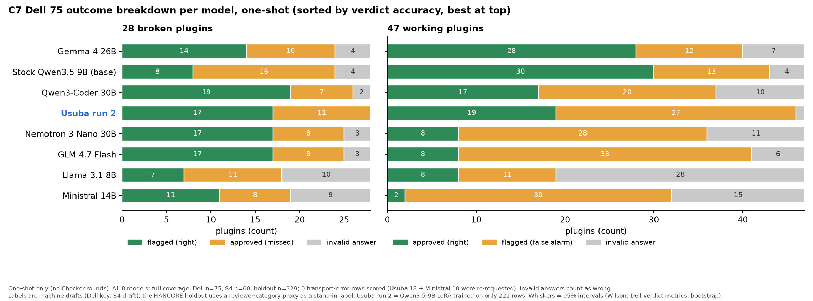

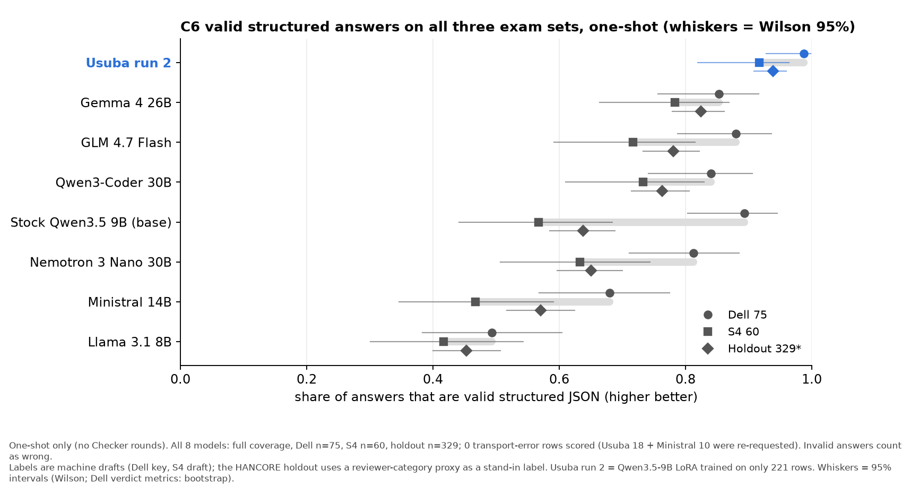

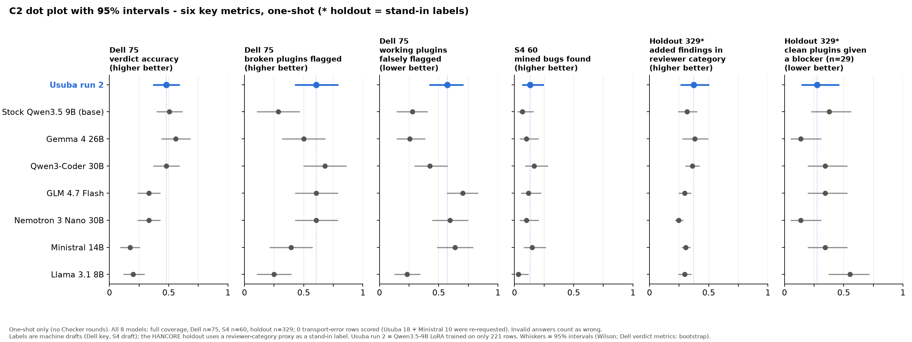

Key numbers are in `data/set2_key_metrics.csv`, and the full set with intervals is in `data/set2_oneshot_tidy.csv`.

| model | Dell verdict acc | Dell broken flagged | Dell false alarm | valid: Dell / S4 / holdout | S4 bugs found |
|---|---|---|---|---|---|
| Usuba run 2 | 0.480 | 0.607 | 0.574 | 0.987 / 0.917 / 0.939 | 8 of 60 |
| Stock Qwen3.5 9B | 0.507 | 0.286 | 0.277 | 0.893 / 0.567 / 0.638 | 4 of 60 |
| Gemma 4 26B | 0.560 | 0.500 | 0.255 | 0.853 / 0.783 / 0.824 | 6 of 60 |
| Qwen3-Coder 30B | 0.480 | 0.679 | 0.426 | 0.840 / 0.733 / 0.763 | 10 of 60 |
| GLM 4.7 Flash | 0.333 | 0.607 | 0.702 | 0.880 / 0.717 / 0.781 | 7 of 60 |
| Nemotron 3 Nano 30B | 0.333 | 0.607 | 0.596 | 0.813 / 0.633 / 0.650 | 6 of 60 |
| Ministral 14B | 0.173 | 0.393 | 0.638 | 0.680 / 0.467 / 0.571 | 9 of 60 |
| Llama 3.1 8B | 0.200 | 0.250 | 0.234 | 0.493 / 0.417 / 0.453 | 2 of 60 |

**Read it this way.** Usuba run 2 has the best valid-answer rate on all three sets. On verdict accuracy it sits in the middle of the pack, behind Gemma 4 26B and stock Qwen3.5 9B. Nothing is above 0.56, and the Checker scripts alone score 0.773. These are machine-draft labels on small sets, so differences of a few points are noise.

The earlier peer chart below (Dell 75 and S4 60 only, one-shot) previously carried a footnote saying the holdout and the Checker-feedback runs were not finished. That is out of date and the chart has been re-rendered without it. The holdout is in the Set 2 charts above and the feedback runs are in Set 3 below.

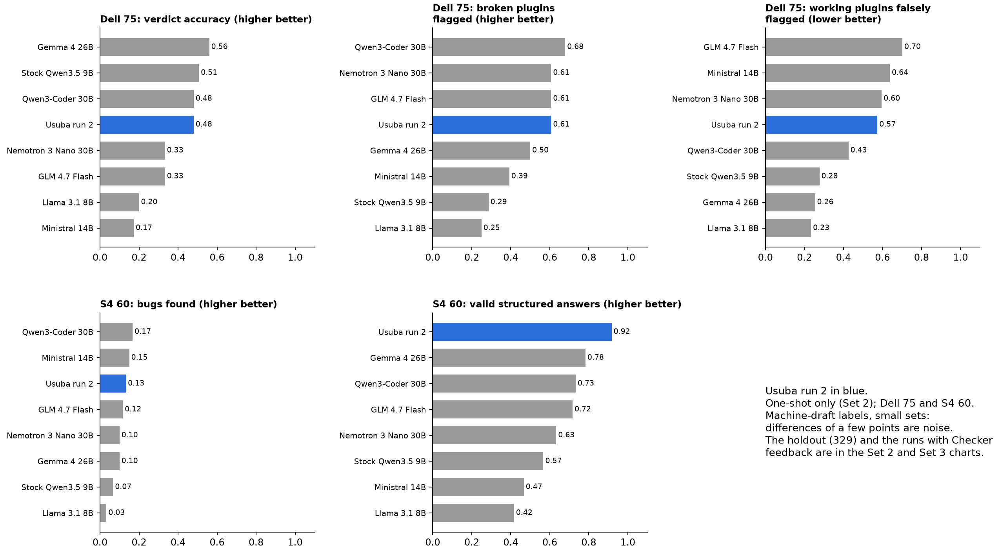

#### Set 3: open models with the Checker feedback loop, including Usuba

**Method.** Same review exam, prompt, schema, post-filter and scorer as Set 2. After the model's first answer, the Usuba Checker (plain code, no model, no labels) checks only the model's own flagged findings: valid structure and triage coverage, the file exists, the line is inside the file, the quote is really in the file and within 2 lines of the cited line, no duplicates, and dismissals are quoted and never of a runtime-stage fail. Only the Checker's failures go back to the model, up to 3 revisions, and the last answer is scored (`scope/feedback.py`, `--feedback-rounds 3`). The Checker never judges whether a finding is true, so the labels are untouched. The same 8 open models ran: Usuba run 2 on the rented H100, the other 7 on OpenRouter.

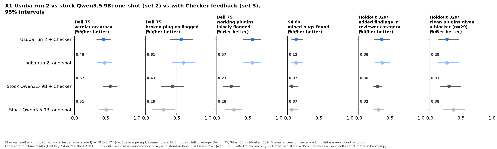
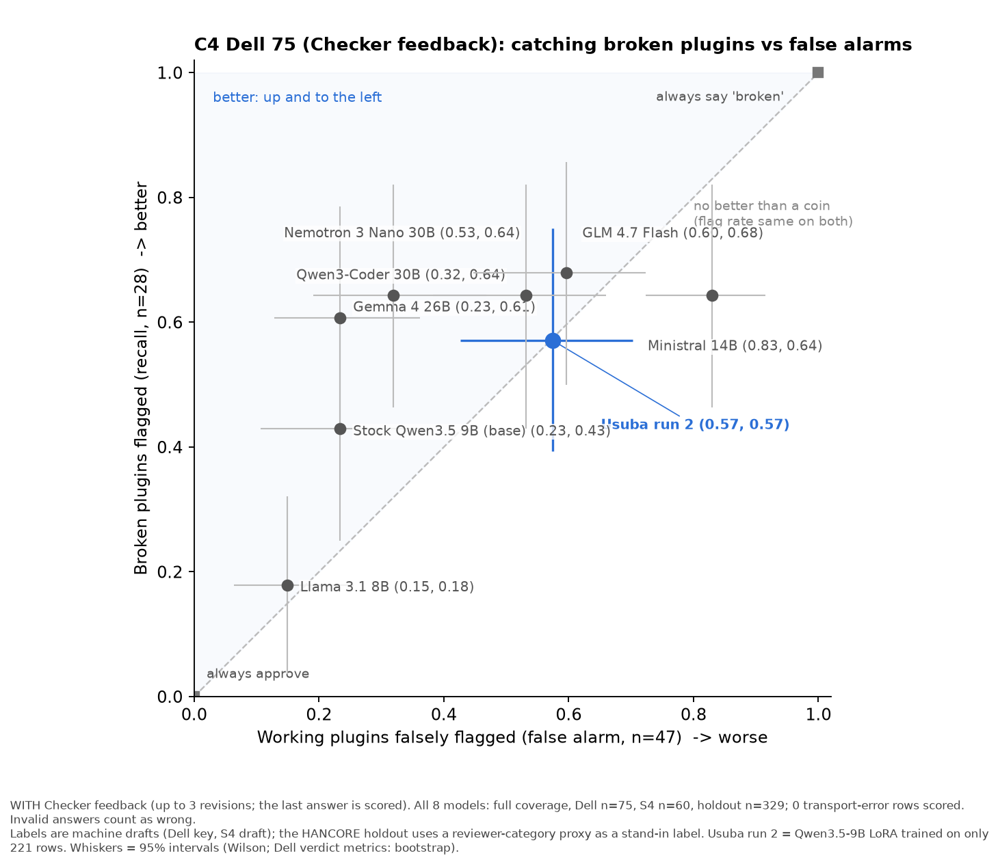
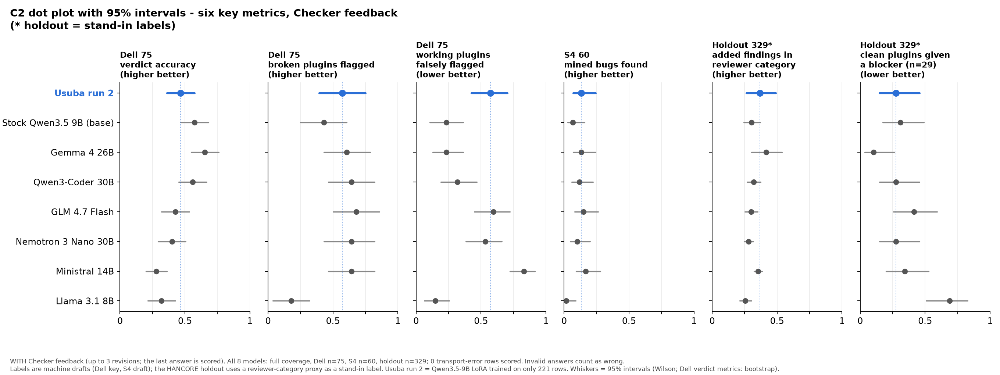
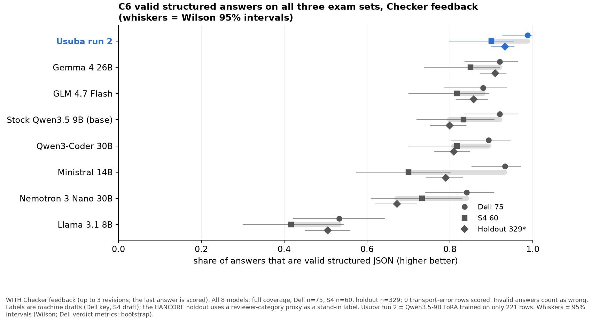
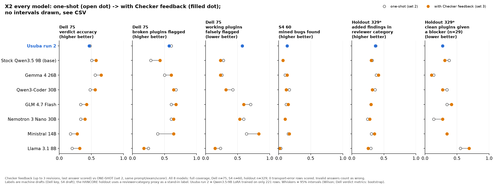

**The honest result, in plain terms.** The Checker loop barely changed Usuba run 2: Dell accuracy was 0.48 one-shot and 0.47 with the Checker, and the intervals overlap almost completely. 70 of its 75 Dell answers already passed every Checker check before any revision, so there was little for the loop to fix. Stock Qwen3.5 9B gained more from the same loop (Dell accuracy 0.51 to 0.57; valid answers on the holdout 0.64 to 0.80). The best Dell accuracy in the panel was Gemma 4 26B with the Checker, at 0.65. That is still well below the Checker scripts alone (0.773).

**Numbers (95% intervals; one-shot is Set 2).**

| | Dell accuracy | Dell broken flagged | Dell false alarm | S4 bugs found | Holdout valid |
|---|---|---|---|---|---|
| Usuba run 2, one-shot | 0.48 [0.37-0.59] | 0.61 [0.43-0.79] | 0.57 [0.43-0.70] | 0.13 [0.07-0.24] | 0.94 [0.91-0.96] |
| Usuba run 2 + Checker | 0.47 [0.36-0.57] | 0.57 [0.39-0.75] | 0.57 [0.43-0.70] | 0.13 [0.07-0.24] | 0.93 [0.90-0.95] |
| Stock Qwen3.5 9B, one-shot | 0.51 [0.40-0.61] | 0.29 [0.11-0.46] | 0.28 [0.15-0.40] | 0.07 [0.03-0.16] | 0.64 [0.58-0.69] |
| Stock Qwen3.5 9B + Checker | 0.57 [0.47-0.68] | 0.43 [0.25-0.61] | 0.23 [0.11-0.36] | 0.07 [0.03-0.16] | 0.80 [0.75-0.84] |
| Gemma 4 26B + Checker (best Dell accuracy) | 0.65 [0.55-0.76] | 0.61 [0.43-0.79] | 0.23 [0.13-0.36] | 0.13 [0.07-0.24] | 0.91 [0.87-0.94] |
| Llama 3.1 8B + Checker | 0.32 [0.21-0.43] | 0.18 [0.04-0.32] | 0.15 [0.06-0.26] | 0.02 [0.00-0.09] | 0.51 [0.45-0.56] |

All eight models' one-shot and with-Checker numbers are in `data/set3_comparison_table.md` and the tidy CSV.

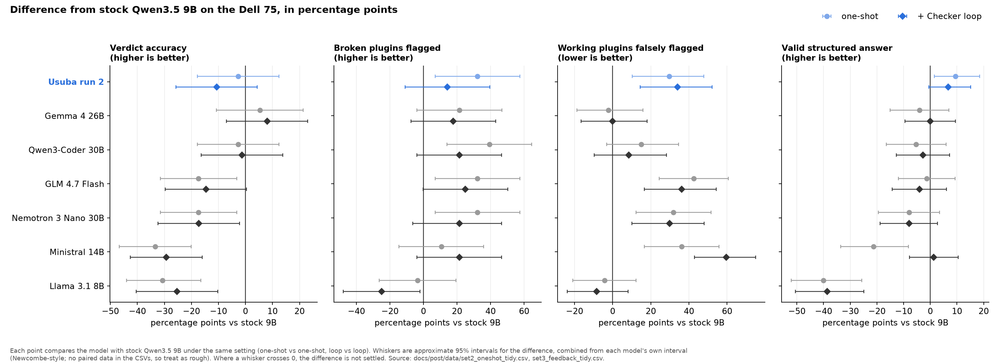

**Honest read.**
- **The loop did almost nothing for Usuba run 2.** Its first answers were already clean most of the time (70 of 75 Dell answers passed every Checker check before any revision; mean 1.12 model calls on Dell, 1.35 on S4, 1.28 on holdout). Every Usuba metric moved by 4 percentage points or less (Dell accuracy went from 0.48 to 0.47), well inside the intervals. It still sits mid-pack on Dell accuracy (0.47) and at 0.57 false alarm.
- **The loop helps models that format badly.** Stock Qwen3.5 9B's valid-answer rate rose from 0.64 to 0.80 on the holdout and from 0.57 to 0.83 on S4; its Dell accuracy rose 0.51 to 0.57, with overlapping intervals. Every other model's Dell accuracy rose, but all the intervals overlap: Gemma 4 26B 0.56 to 0.65, Qwen3-Coder 30B 0.48 to 0.56, GLM 4.7 Flash 0.33 to 0.43, Nemotron 3 Nano 0.33 to 0.40, Llama 3.1 8B 0.20 to 0.32. Holdout valid answers rose clearly for Ministral 14B (0.57 [0.52-0.62] to 0.79 [0.74-0.83]). Ministral 14B is a warning: accuracy 0.17 to 0.28 came with false alarms 0.64 to 0.83.
- **The Checker checks format and quotes, not truth.** None of this changes the bar: Usuba run 2 still does not clear it, and bug recall on S4 stays at 0.13.
- **Coverage.** Dell 75 and S4 60 are complete for all 8 models. The holdout (329 plugins) is complete for all 8 models; Llama 3.1 8B's slow holdout feedback run finished the evening of Oct 16. Its holdout valid answers rose from 0.45 to 0.51, but category precision fell from 0.30 to 0.25 and clean holdout plugins given a blocker or invalid answer rose from 0.55 to 0.69, with overlapping intervals. Transport-error rows were never scored and were re-requested (Usuba 6, Ministral 18, stock Qwen 1, Llama 1).
- Labels are machine drafts and the holdout uses a reviewer-category proxy.

[Raw data: `data/set3_feedback_tidy.csv`, `data/set3_feedback.json`; charts and scripts: `charts-set3.zip`; post-level chart scripts: `charts/make_post_charts.py`.]

### Decisions and context

- **Set 1 choices.** The panel is 11 models; the earlier Oct 13 uplift had 12, including Grok 4.3. On Oct 16 I set the model mix as the old chart's with Grok 4.3 dropped (11 models). No reason for the drop was given in chat. I approved Muse Wonder without ZDR on 2026-10-13 (its only provider isn't ZDR); the disclosure is in `TABLE.md` and the chart footnote. I also approved the costs on 2026-10-16 ("all those costs are fine let's finish this out"; my figures were about $67 for Set 1 and about $10 for Set 3). Set 1 actually cost $97.47 including the discarded run, and Set 3 peers are at $9.08 so far. Everything else kept ZDR. The rerun had a $75 hard stop (it spent $34.00), and the request timeout was cut from 600 to 240 seconds.
- **How the hand check was done.** Code was read prompt by prompt across models, blind, by an agent, not by a person. The Dell load test used isolated runs, at my direction, and plugins with destructive command strings weren't run on the laptop. A 42-row spot check found 40 clear agreements and 2 borderline calls, which were kept.
- **A correction to the "116 not run" line.** Per `STATUS.md`, the 116 include the destructive-string candidates (76 + 36, minus overlap) and also five manifest-only answers across their rows, not only destructive code. The bullet in Set 1 has been adjusted.
- **What the Checker alone would have said.** By fix round 3 the Checker passed Opus 49 of 49, Muse 49, GPT-5.6 Sol 46, Sonnet 48 and Kimi 46. After the code read and Dell load test, the passing counts are 38, 35, 32, 32 and 34. Passing the Checker is not the same as working, which is the point of the three-part pass test.
- **The question that fixed the labels.** On Oct 16 I asked what "still buggy" is based on and whether hardware verified it, then said "we need different language there" and asked for the terminology to change without re-running the test. In the export code it meant: loads but Checker errors remain, or passed the Checker but failed the code read. That isn't "buggy" in a provable sense, so the chart now says **failed checks** (and "fully broken" became **no usable code**), with the footnote "Failing does not prove a plugin is broken." The mapping is in `set1_stacked.py`.
- **"Verify while it runs."** After the pairing bug I said on Oct 16: "Let's get it right and move forward" and "you should verify it while it's running - don't let the whole damn thing run." In the files that shows up as follows. At 1:30 PM `test_round0.py` ran over the first 141 fresh rows (0 mismatches, fix-round outputs kept the same manifest id), and the check was repeated at each monitoring pass.
- **Set 2 and Set 3.** Gemma 3 12B was dropped from the panel, leaving 8 open models. Nemotron, Gemma 4 and Llama ran without a ZDR requirement (my call). The Set 3 loop is `scope/feedback.py` (runs labelled `fb3`), built by a worker from a short spec; I still need to confirm it matches what I intended. Spend on Set 3 peers is $9.08 (cap $15) in `scope-v4/peers-fb/spend.json`, and all Usuba run 2 feedback runs finished.
- **Stuck request, checked before killing.** At 12:34 PM the uplift looked hung but wasn't (its spend file had updated minutes earlier), so nothing was killed. At 12:57 PM one DeepSeek row had no spend or log change for 17 minutes. That one was genuinely stuck, so we killed it, kept a backup of the ledger, and relaunched with the shorter timeout.

> **What we learned**
>
> - Different questions need different tests, so the three sets keep their methods separate.
> - A failed run is still money: Set 1 cost $97.47, and $63.47 of it was a first run we threw away because of a pairing bug.
> - Set 3 shows the feedback loop helps models with bad formatting (stock Qwen valid answers 0.64 to 0.80 on the holdout) but did almost nothing for Usuba run 2.

### Bridge to Part 3

Part 2 gives us a ruler we trust (the Checker scripts) and a clear reading of our model against it: it didn't clear the bar. What do you do with a result like that? We publish it. Part 3 says what we are releasing, what we are not claiming, and how you can help.

---

<!-- ===== PART 3 START ===== -->

# Part 3 · Own: release "In Training," what we claim, how to help

*Question: what do we do with a model that didn't clear the bar, and who owns what comes next?*

**TL;DR.** We plan to release the Usuba Checker scripts as the working part and the Usuba Checker model as "In Training" on Monday, 2026-10-19 (nothing is announced until I say so). The release says plainly that the model did not clear the bar, lists what we are not claiming, and asks for labelled data, bug reports and compute.

> **In this series**
>
> - Part 1 · Build: We set out to teach a 9B model to review Omarchy plugins. We built a clean training set from git history and trained two LoRA runs (4,592 training rows for run 1, 221 for run 2). Neither beat its stock base on judgment.
> - Part 2 · Evaluate: The Checker scripts score 0.773 on the Dell 75. No model is above 0.56 one-shot, or above 0.65 with the Checker loop. We also show how our own scores lied to us before we fixed the exams.
> - **Part 3 · Own** (you are here): We release the model as "In Training," say plainly it did not clear the bar, and ask for data, bug reports and compute.

---

## Epoch 10 · Oct 16 (planned release Oct 19): Release as "In Training"

We plan to release the Usuba Checker model on **Monday, 2026-10-19**, labelled **"In Training."** We're not announcing it until I approve.

The release note will say it plainly: **it did not clear the bar.** Our own rule was that the model has to beat a frontier model run as a skill, or the honest release is the Checker scripts plus a skill. Our release bar for naming the real reason was 0.60 of flagged plugins. On the Dell sweep, the Checker scripts alone beat every model on verdict accuracy. Run 2 learned the output format and stopped inventing so many findings. It didn't get better at telling working plugins from broken ones.

The Checker scripts are the part that works. They're the ruler. The model is early, and we'd like help with it:

- more and better labelled data, especially in-use bugs and false alarms from real plugins
- reports of where the model and the Checker scripts disagree with your machine
- compute and evaluation time for the next run

### Decisions and context

- **Publish while in training.** On Oct 15 I decided to publish the Usuba training result either way, labelled "In Training", plainly stating it did not clear the bar and inviting participation and help. This supersedes the earlier stance of no release until it passes. I prepped the release for Monday 2026-10-19, and nothing is announced without my say-so.
- **The bar, in two versions.** The retrain plan's gate (Dell accuracy at least 0.85, false alarms at most 0.15) and the right-reason release bar (at least 0.60 of flagged plugins) both stay unmet. The model's best Dell accuracy is 0.480 on the 75-plugin set.
- **Nothing is announced until I say so.** The planned date (Mon Oct 19) is a plan.
- **Open questions.** (1) Whether the Set 3 loop spec (Checker validates flagged findings, up to 3 revisions) is the one I want; it did not change this stance. (2) Whether to loosen the v2-validation-repo exclusion. (3) Whether to test the 4-bit GGUF and Dell CPU speed before release. (4) Who or what wrote the 51 "house" training rows and AI-assisted community plugins (the audit left this open). (5) Whether to hand-audit the 27 HANCORE false alarms (plan §4).

Set 3 result: with the Checker feedback loop Usuba run 2 does not change in any measurable way (Dell accuracy 0.47 [0.36-0.57]), so the stance above stands.

---

## What we are releasing and what we are not claiming

*[DRAFT for Harris: wording for the Monday, 2026-10-19 "In Training" release. Nothing here is announced or posted until Harris approves.]*

**What we are releasing.** The Usuba Checker scripts and the public standard (the part that works), and the Usuba Checker model, labelled **"In Training"**. The model is stock Qwen3.5-9B plus a LoRA (adapter about 350 MB), with a 4-bit Q4_K_M file of 5.63 GB. We have not tested that 4-bit file on any exam set. Our run 2 numbers come from the bf16 merge.

**What we are not claiming.**

- **It did not clear the bar.** Our bar was to beat a frontier model run as a skill, or ship the Checker scripts plus a skill. Run 2 did not do that. Its best Dell accuracy is 0.480 against 0.773 for the Checker scripts alone.
- **Better format is not better judgment.** Run 2's valid-answer rate is the best of the eight models, and that is all that chart shows. It still raises false alarms on working plugins (0.574).
- **The Checker loop did not rescue it.** With the Checker loop, Dell accuracy was 0.47 against 0.48 one-shot.
- **No claim about the 4-bit file's speed or accuracy,** the Dell CPU, or other models' results beyond the labelled, machine-draft exam sets in this post.

**How you can help.** Send us labelled in-use bugs and false alarms from real plugins. Tell us where the model and the Checker scripts disagree with your machine. Offer compute or evaluation time for the next run. If you want a builder-grade model for Omarchy plugins, get in touch.

---

## Where it stands

This is a snapshot from Wednesday, Oct 14, 2026, except the spend line, which is refreshed below. For the Oct 16 results see Epochs 8 and 9. These are the numbers we can point at in the repo and the billing ledgers.

**Spend (as of Oct 14).** About **$207**: **$77.67** on GPU (Vast) and **$129.73** on AI services (OpenRouter project ledgers). That's a lot more than "tens of dollars." It doesn't include the Oct 14 to 16 work in Epochs 8 and 9. [TK: confirm the total against the Vast and OpenRouter billing pages.] A provisional figure derived from the ledger and run files is in Appendix C: about $400 through Oct 16, 6:58 PM (before the final Vast bill for the instance destroyed at about 7 PM). The real cost is still the time on data and evaluation, but the cash number belongs in the open too.

**Grader vs. the Dell.** Agreement with the hardware answer key went from **44/58** on the old grader to **90/90** decided once we rebuilt it against the Dell and grew the key.

**Checker scripts vs. the Dell sweep.** Agreement with the sweep key went from **45/52** to **52/52**.

**Builder fine-tunes.** None of them beat stock on the clean /49 holdout. Our fine-tunes landed around **2–4/49**. Stock open models were about **3–6/49**. We never cleared the first bar: beat your own base.

**Frontier builders with Checker feedback (earlier count, Oct 13).** First try, then after the Checker-feedback fix loop: GPT **21 → 40/49**, Opus **17 → 36**, Sonnet **9 → 35**. That count used the Checker alone as the pass test. Epoch 9 (Set 1) replaces it with a fresh run and a three-part pass test (see Epoch 4 for how the numbers moved).

**Checker model on the Dell set (corrected).** The Oct 14 version of this paragraph quoted 0.756 for Usuba v1 against 0.567 for stock Qwen3.5 9B. Those came from the leaky prompts described in Epoch 7, so we've dropped them. On the leak-free key, Usuba v1 scores 0.700 (as trained) and stock 9B with the old prompt scores 0.556. By the judge's count, Usuba v1 named the real reason for 0 of 33 broken plugins.

**Prompt matters more than we hoped.** On the older 90-row Dell key (a different, historical exam, not comparable with the Dell 75), stock 9B with a better prompt hit **0.800** and Ministral 14B **0.822**. Before we spend more on training, we have to beat a stock model with a better prompt.

> **What we learned**
>
> - The grader and the Checker scripts are the measured wins. The builder fine-tunes aren't.
> - A prompt change on a stock model can outscore our first trained run, and run 1 couldn't name the real reason.
> - Run 2 learned the format. The judgement is still the Checker scripts' job.

---

## What specialist models really take

A big part of the inspiration for this project came from the Coinbase team. Coinbase is not a sponsor of this work. Separately, Brian Armstrong personally donated $1 million to the Omacom Foundation, and his post about Coinbase's work is what prompted this project. While we were doing this, Brian Armstrong [posted](https://x.com/brian_armstrong/status/2109412046244913643) about Coinbase's fraud agent, and Coinbase's own write-ups ([part one](https://www.coinbase.com/blog/part-one-how-coinbase-built-evaluated-and-post-trained-a-fraud-agent), [part three](https://www.coinbase.com/blog/part-three-owning-intelligence-series)) say they post-trained Qwen3.5-9B with reinforcement learning and that it beat Opus 4.5 on their fraud benchmark, with 55% lower latency than Opus 4.5. They do not give an inference-cost comparison, so we won't claim one. Fraud is a high-volume task with a lot of proprietary data, which is where a specialist model can win.

One [reply](https://x.com/trashpandaemoji/status/2109959474978930940), from @trashpandaemoji, described what it takes to get there. After three years of fine-tuning small models for special purposes, they said it's good for high-volume or low-latency tasks, but it isn't cheap, and you end up in a never-ending cycle of dataset work.

That matches our experience, and it's useful to know going in. Every fine-tune sent us back to the data: what to include, how long the targets should be, why the model loops. A specialist model isn't a weekend fine-tune. It's an ongoing investment in data and evaluation. The part that lasts is the evaluation: the grader and the standard stay useful whichever model wins, and they're what make a good specialist possible.

On cost: the cash number is bigger than I first guessed. See "Where it stands" for the figure from the ledgers. The larger investment is still the time spent on data and evaluation, not the GPUs.

---

## What's next, and how you can help

I want to be straight about this: it has been a lot of work. Calibrating a grader against a real laptop, sweeping thousands of plugins on hardware, re-running jobs after an audio plugin took down the desktop, chasing bugs through GitHub issues, building a training set with provenance on every row. None of it was quick, and most of it was data and evaluation, not GPUs.

Omarchy will keep changing, and every release can change what "working" means. So the Usuba Checker scripts and the standard need ongoing maintenance: new rules for each gap we find, and new hardware checks on each release. The Usuba Checker model needs the same, starting with the holdout comparison above.

Long term, a standard for what counts as a working Omarchy plugin probably belongs with Omarchy itself, as an Omacom project. We're happy to build it in the open until then and hand it over in whatever shape makes sense.

I'd love help maintaining and improving all of this:

- **Omarchy maintainers:** review the rules against your intent for the plugin contract, and tell us when an upcoming release will change something. Open an issue or PR on [the repo](https://github.com/outboundsync/usuba-checker-scripts).
- **Plugin authors:** run the Usuba Checker scripts on your plugins and report false passes and false fails, especially in-use bugs. Open an issue on [the repo](https://github.com/outboundsync/usuba-checker-scripts/issues).
- **Anyone who wants to help with the model:** help us evaluate and improve the Usuba Checker model. We are not soliciting donations. Feedback and changes are welcome as GitHub [issues](https://github.com/outboundsync/usuba-checker-scripts/issues) or [pull requests](https://github.com/outboundsync/usuba-checker-scripts/pulls); the repos are public.

And I'm still interested in a builder-grade model, one that actually helps people ship working Omarchy plugins. The Checker is what makes that possible to train honestly. If you want that too, get in touch.

I'll keep posting what we find, including what doesn't work.

*Harris Kenny, OutboundSync*

<!-- ===== APPENDICES START ===== -->

# Appendices

## Appendix A · Decision log

Dates are America/Denver time. "Source" is a file or commit in the repo or run directories. Entries sourced to "my instruction" are decisions I gave in chat, dated from memory of the chat and not re-checked against a transcript.

| Date (2026) | Decision | Source ("my instruction" entries are from chat memory, unchecked) |
|---|---|---|
| Oct 11, night | Every training example needs a license paper trail at a pinned commit (data rule v1). | `DATASET.md`; outline §2 |
| Oct 11, 10:58 PM | Vast credit bought: $100 prepaid. | progress ledger row 2 |
| Oct 12, 5:24 AM | Frontier panel on OpenRouter with ZDR on. Qwen2.5-32B and GLM 5.3 Prime were left out because they weren't ZDR-compatible. | `runs/smoke-2026-10-11/PROGRESS.md`; outline §4 |
| Oct 12, 9:44 AM | Data rule v2: merged and reviewed code only; no model-written or frontier-distilled rows; holdout deduped 56 to 49. | repo history |
| Oct 12, 12:21 PM to 4:37 PM | Project renamed from Santoku to Usuba (still "Santoku" at 12:21 PM; "Usuba is the name" in the 4:37 PM draft). | repo history |
| Oct 12, 2:07 PM to 3:38 PM | The Dell laptop becomes the ground truth; the blind round's verdicts are sealed before running. | repo history |
| Oct 12, 8:04 PM | Loops and truncations count as fails when rescoring all models. | repo history |
| Oct 12 to 13 | RL plan put on hold after best-of-16 showed all-zero reward groups. | outline §12 |
| Oct 13, 7:07 AM | Pivot: build the Checker (ruler) before any model. | repo history |
| Oct 13, 11:47 AM | Base model locked: Qwen 3.5 9B, 4-bit, 32 GB iGPU laptop floor. | `docs/TRAINING_PLAN.md` |
| Oct 13 | Guardrails: a human presses merge, send and deploy; agent work on Cursor house models only (composer-2.5, grok-4.6 for planning or audit). | `docs/TRAINING_PLAN.md` |
| Oct 13, 3:52 PM | HANCORE holdout frozen (329: 300 positives, 29 negatives). | repo history |
| Oct 13, 4:49 PM | USB-W02 turned on as a non-blocking warning by maintainer override (precision 0.43). | repo history |
| Oct 13, 8:47 PM | Severity rule: a QML message fails a plugin only if it stops a component being created. | repo history |
| Oct 13, 9:47 PM | Rename: "Usuba Builder" becomes the Usuba Checker model; "Usuba Checker" becomes the Usuba Checker scripts. | repo history |
| Oct 13, 9:11 PM | The 116-row Dell key is excluded from training and kept as a gate. | `docs/TRAINING_PLAN.md` |
| Oct 14 | Leaky prompts fixed; older Dell-key numbers marked "do not cite". | `eval/dellkey/README.md` |
| Oct 14, 2:28 PM | Comparisons are open-source only; Sonnet is not a comparison row. | repo history |
| Oct 14 | Retrain plan v2 written (gate on the Dell key; HANCORE false alarms reported, not gated; budget cap $35). Nothing rented. | `usuba-retrain-plan.md` |
| Oct 15 | Claude stays in score tables only; six Claude-built plugins leave the Dell key (90 to 86 rows); Haiku judge replaced by gpt-oss-120b; early Sonnet scripts removed from private-repo history. | `docs/ANTHROPIC_TERMS_COMPLIANCE.md` |
| Oct 15, afternoon to night | Labels come from git history, not from people. | `STATUS.md` §0 and §3; my instruction, Oct 16 for the rule |
| Oct 15, 8:09 PM | Miner v2: clean versions may keep up to three unlabelled warning findings, adjudicated as provisional. | `STATUS.md` §3 |
| Oct 16, 1:16 AM | LLM label-spend cap raised to $19.35 under my $20 ceiling. | `STATUS.md` §3 |
| Oct 16, 2:35 AM | Build stopped at $19.64 with 28 of 40 shards. | `STATUS.md` §3 |
| Oct 16, ~2:43 AM | Train on 238 rows even though the 300-row stop rule would have blocked it; real safety gates stay. | my instruction, Oct 15; `NOTIFY_HARRIS.md`; `post_chain/gates.log` |
| Oct 16, 4:26 AM | A100 rental approved for the exam rerun, cap about $4. | `STATUS.md` §3 |
| Oct 16, 5:27 AM | Finish all 40 shards, hard stop $40 total build spend. | `STATUS.md` §3 |
| Oct 16, 11:03 AM | Keep the run 2 instance for the Checker-feedback runs instead of destroying it. | `STATUS.md` watch lines |
| Oct 16, 1:45 PM | Discard the first Set 1 run; rerun with a $75 hard stop, 240-second timeout, ZDR on (Muse excepted). | `runs/uplift-fresh` progress notes |
| Oct 16, 2:50 PM | Set 1 hand check done blind per prompt; Dell load tests run isolated, at my direction; destructive-string plugins not run. | `CHECKER_CHARTS_PROGRESS.md` |
| Oct 16 | Set 1 labels renamed ("still buggy" to "failed checks", "fully broken" to "no usable code"). | `runs/uplift-fresh/set1_stacked.py`; my instruction, Oct 16 for the question |
| Oct 16 | Model mix = the old chart's with Grok 4.3 dropped (11 models; Grok 4.7 stays). No reason given. | my instruction, Oct 16; 11 models versus 12 in `runs/uplift/TABLE.md` |
| Oct 13 | Muse Wonder approved without ZDR, with a disclosure. | my instruction, Oct 13; `runs/uplift-fresh/TABLE.md` note |
| Oct 16 | ZDR not required for Nemotron, Gemma 4 and Llama rows. | `eval/dellkey/README.md` |
| Oct 15 | Publish the training result either way, labelled "In Training", saying plainly it did not clear the bar; supersedes "no release until it passes". | my instruction, Oct 15 |
| Oct 12 | Bar for promoting the fine-tune: near or beating frontier models (Opus, GPT, Gemini) cheaply or locally, holding up on a clean deduplicated test set, and a real user building a working plugin. | my instruction, Oct 12 |
| Oct 12 | Keep OpenRouter zero data retention on. | my instruction, Oct 12 |
| Oct 12 | Train only on merged, reviewed plugins with recorded provenance. | my instruction, Oct 12 |
| Oct 12 | Usuba domain bought; no landing page until there are real results. | my instruction, Oct 12 |
| Oct 12 | Cursor cloud agents and helpers use only house models (composer-2.5, Grok), after a cost blowup. | my instruction, Oct 12 |
| Oct 15 | Run the training regardless of the row-count stop rule; only real safety checks (guards, train/validation leakage, disk and credit) block the chain. Overrides the earlier hold until HANCORE recovery, Checker false-positive fixes and a larger val set. | my instruction, Oct 15 |
| Oct 16 | Delegated the final call on the training row floor and per-kind caps to the assistant: pick the most rows that keep every reported number honest, and show the tradeoff table. | my instruction, Oct 16 |
| Oct 16 | GPU training as an automated chain with hard gates, shown before arming. | my instruction, Oct 16 |
| Oct 16 | Standing permission to use my Dell to test plugins when code reading can't settle it (each Dell command still needs approval); hardware-tested rows are marked on charts. | my instruction, Oct 16 |
| Oct 16 | Three chart sets built from the old v1 chart's shape only. | my instruction, Oct 16 |
| Oct 16 | Costs approved: "all those costs are fine let's finish this out" (my figures: Set 1 about $67, Set 3 about $10). | my instruction, Oct 16 |
| Oct 16 | Post structured in epochs with clear phases of learnings, in one directory with images, with all chat context captured. | my instruction, Oct 16 |
| Oct 16 | Release prepped for Monday 2026-10-19; nothing announced without me. | my instruction, Oct 16 |
| Oct 19 (planned) | Release the Usuba Checker model as "In Training." | this draft |

---

## Appendix B · Mistakes we caught

| What went wrong | How it was caught | What changed |
|---|---|---|
| The first 7B fine-tune looped, and we blamed the serving path. | Merged weights with a repetition penalty still truncated 42 of 56. | Diagnosis moved to the training targets (19 to 74k character gold answers). |
| Validator scores made a tuned 7B look as good as GPT-5.6 (42 against 40 of 56). | The first real-Quickshell box test: 42 fell to 8. | A functional grader became the first piece of work. |
| The old grader passed plugins that were broken on the Dell (44/58 agreement). | Dell batch 2 and 3 labels. | Grader rebuilt; sealed blind round; 90/90. |
| A "49/61" agreement claim that can't be reproduced. | Recount from the batch 3 labels. | Post uses 44/58 to 58/58 instead. |
| The fix loop looked like it worked (5 to 13 of 49). | Manual review of all 13: only 4 real (5 firm, 7 lenient on a second prompt). | Checker hardened; "the grader is the product." |
| Leaky prompts: `SOURCE.txt` and an "expected fooled case" checklist in every Dell-key prompt; files cut short. | Reading the prompts behind a surprisingly good score. | Files dropped; numbers redone (0.756 to 0.700; 0.567 to 0.556). |
| Verdict accuracy flattered run 1 (always "broken" scores 0.912 on the holdout). | Right-reason grading found 0 of 33 and 46 invented SHAs or names. | Reason and false-alarm rates became the metrics; HANCORE reported, not gated. |
| The Haiku judge (Anthropic) graded the right-reason numbers. | The Oct 15 terms audit. | Open judge (gpt-oss-120b); old numbers labelled "historical". |
| An invalid exam: llama-server context 16k over 4 slots (1,002 of 1,054 requests failed). | Counting context-overflow errors. | 32k per slot and automatic abort guards. |
| A grader that disagreed with hardware on the new runtime (Checker crash on object kinds). | Key regression run. | Fixed Oct 13, 9:16 PM; USB-D06 added. |
| An audio plugin rerouted system audio and the shell grew to 13 GB. | The Dell sweep went out of memory. | 194 jobs thrown out and re-run in isolated sandboxes. |
| A data driver started shards before mining finished (about 1,000 of 5,033 plugins). | Watcher noticed at 7:53 PM Oct 15. | Chain stopped and re-armed to wait for mining. |
| A hung OpenRouter call (over 9 minutes) in the data build. | Zero cache writes while the process held a socket open. | 300-second wall-clock cap per call. |
| The JSON error gate tripped on one shard (3.1% against 1%). | Build stopped. | Raised to 4% for these labels; the gate is looser than designed. |
| Exam hosts failed: one unreachable, one vanished (192 poisoned `URLError` rows), a tunnel died (18 error rows). | Watch logs and cache audits. | Poisoned rows stripped and re-run; exam finished with 0 error rows. |
| **The pairing bug.** Set 1 answers were matched to prompts by position, but the files were in completion order. | Only 3 to 19 of 49 first answers per model matched their prompt (found when the hand check started). | Keyed by prompt id; a test checks every first answer; the first run was thrown away ($63.47). |
| A "stuck" request. | Checked spend and log files before killing. At 12:34 PM it wasn't stuck; at 12:57 PM a DeepSeek row had no change for 17 minutes. | Killed that one, kept a ledger backup, timeout 600 to 240 seconds. |
| "Still buggy" meant "failed Checker or code read," not "provably broken." | My question about the label, 2026-10-16. | Renamed to "failed checks," with a "failing does not prove a plugin is broken" footnote. |
| The draft said the Oct 13 uplift used the Checker alone, and that Epoch 9 numbers were lower. | Re-reading `export.py` and the Set 1 table for this update. | Both sentences corrected (Epoch 4 and "Where it stands"). |
| The "116 not run" line blamed destructive code only. | `STATUS.md` for Set 1 says some were manifest-only answers. | Sentence corrected in Epoch 9. |

---

## Appendix C · Spend by phase

Only figures that appear in files are listed. **TK** means no figure was found. "Prepaid" is a deposit, not spend.

| Phase | Item | Amount | Source |
|---|---|---|---|
| Epochs 1 to 2 (Oct 11 to 12) | Vast credit bought (prepaid) | $100 (Oct 11) | progress ledger row 2 |
| | 7B smoke fine-tunes (A100 SXM4, $1.07/h) | TK (rate only) | smoke `PROGRESS.md` |
| | 14B run (A100 $0.935/h) | about $0.79 | smoke `PROGRESS.md` |
| | Frontier panel on OpenRouter | about $33.50 from logs (first-pass `panel_costs.txt` sums $11.32); credit ran out at $38.49 of $40 | outline §4; ledger row 4 |
| | Outside expert reviews | $0.12 | ledger row 9 |
| | Dell hardware tests | $0 (own laptop) | ledger rows 10 to 12 |
| Epoch 3 (Oct 12 to 13) | Stock open-base tryout (6 models) | about $3 | `runs/basetry/README.md` |
| | 27B LoRA (H100 NVL, about 3.9 h) | about $11.8 | `runs/q27/README.md` |
| | Fix loop on stock 27B | $7.15 ($2.16 + $2.60 + $2.39) | `runs/fixer/README.md` |
| | Other 7B runs, sweep, best-of-16, harvest | TK (about $31 of Vast spend is not broken out per run) | progress ledger |
| Epoch 4 (Oct 13) | Uplift: 12 builder models | $70.44 | `runs/uplift/spend.json`; ledger row 23 |
| Epoch 5 (Oct 13) | Dell sweep and Checker hardening | $0 | ledger rows 21, 26, 27 |
| Epoch 6 (Oct 13 to 15) | Mining: judge calls for the first round | about $11 (earlier draft figure) | draft v0.4 |
| | Stock 9B holdout baseline | $0.25 | ledger row 28 |
| Epoch 7 (Oct 13 to 14) | Run 1 rental (H100 NVL, about 11.1 h at $3.07/h) | about $34 (estimate) | `docs/TRAINING_PLAN.md` |
| | Sonnet on the holdout / on the Dell key / stock 9B on Dell | $11.05 / $2.08 / $0.04 | ledger row 29 |
| | Right-reason judging | $0.0124 | ledger row 32 |
| | Retrain diagnosis and prompt tests | $1.43 and $0.66 | ledger rows 33, 34 |
| | Anthropic-terms regrade | about $0.02 | `docs/ANTHROPIC_TERMS_COMPLIANCE.md` |
| Epoch 8 (Oct 15 to 16) | Data build LLM spend (caps $20, then $29.5, then $40) | $30.74 | `STATUS.md`; `LIVE_STATUS.md` |
| | First scope-v4 run (H100, $3.031/h) | preflight estimate $5 (cap $36); actual TK | `post_chain/gates.log` |
| | Exam A100s ($1.125/h and $1.325/h) | cap about $4; actual TK | `STATUS.md` |
| | Run 2 (rented H100 PCIe, $2.624/h, started 6:30 AM; destroyed about 7 PM MT) | credit fell from $52.36 (7:20 AM) to $21.97 (6:58 PM) = $30.39; final bill not yet read (about 12.5 h at $2.624/h would be about $33, an estimate) | `STATUS.md` watch lines; `56245451/rental.txt` |
| | Stock 9B baseline on the scope exam | $1.84 (all scope-v4 runs) | `scope-v4/spend.json` |
| Epoch 9 (Oct 16) | Set 1 valid run + discarded run | $34.00 + $63.47 = **$97.47** | `uplift-fresh/spend.json`; tainted ledger |
| | Set 2: 8-model one-shot peers | $3.67 ($3.668 in the file) | `scope-v4/peers/spend.json` |
| | Set 3: Checker-feedback peers and stock Qwen (OpenRouter; Usuba self-hosted on Vast; cap $15) | $9.21 (final) | `scope-v4/peers-fb/spend.json` |
| **Total as of Oct 14** | Vast $77.67 + OpenRouter ledgers $129.73 | **$207.40** (up to $285.43 with account-wide OpenRouter) | progress ledger |
| **Provisional since** | Derived, not audited: $207.40 + $142.80 OpenRouter ledger figures for Oct 15 to 16 (data build $30.74 + scope-v4 exam $1.84 + Set 2 peers $3.67 + Set 3 peers $9.08 + Set 1 valid run $34.00 + Set 1 discarded run $63.47) + $50.36 Vast credit drop ($72.33 on Oct 14 to $21.97 at 6:58 PM Oct 16, assuming no top-up since) | **about $400.56** | derived from files on disk; confirm against billing [TK] |

The derived total leaves out any OpenRouter job that isn't in a project ledger, and it counts the Vast credit drop as one lump, so it can't be split by instance. It stops at 6:58 PM, so it misses the last hour or so of run 2's rental before it was destroyed. The credit fell from $65.48 (about 2:42 AM Oct 16) to $21.97 (6:58 PM), which is $43.51 across the first run, the exam A100s and run 2. The earlier provisional line in v0.6 (about $391) used $139.95 for the Oct 15 to 16 OpenRouter figures; I couldn't reproduce that number, and this version uses the itemised ledger figures instead.
